<div align="center">

<a href="https://github.com/xaviermsd/whatsapp-audio-stickers-india">
  <picture>
    <source media="(prefers-color-scheme: dark)" srcset="docs/brand/banner-dark.png">
    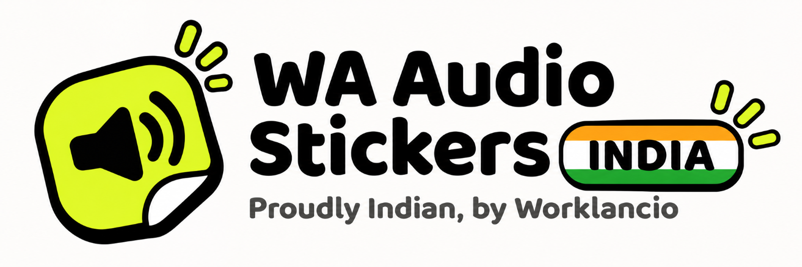
  </picture>
</a>

### Make WhatsApp stickers that play sound, from any video, GIF, photo or your own voice.
### Free. Private. Runs in your browser. Proudly made in India.

[](https://github.com/xaviermsd/whatsapp-audio-stickers-india/releases/latest)
[](LICENSE)
[](https://github.com/xaviermsd/whatsapp-audio-stickers-india/stargazers)


**English** · [हिंदी](docs/readme/README.hi.md) · [Português](docs/readme/README.pt-BR.md) · [Español](docs/readme/README.es.md) · [Bahasa Indonesia](docs/readme/README.id.md)

**[Download](#install)** · **[How to use](#how-to-use)** · **[What's new](#whats-new)** · **[FAQ](#faq)** · **[हिंदी](#hindi)** · **[Worklancio](#worklancio)**

<br>

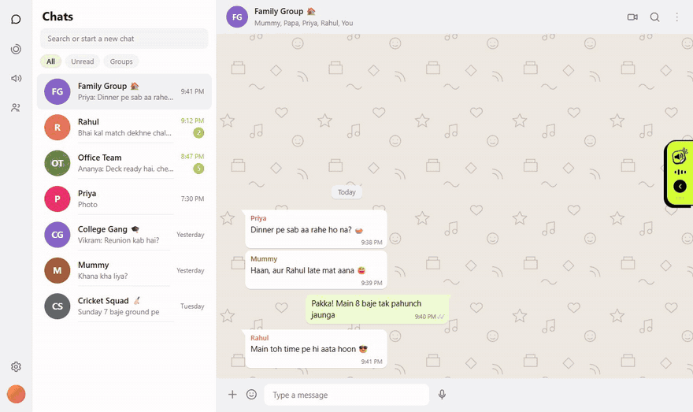

</div>

---

## ✨ What it does

WA Audio Stickers India adds a small lime tab to **WhatsApp Web**. Click it, drop in a clip, cut the funny part,
add a caption and press **Send**. Your friend gets a sticker that plays its sound when they tap it, on Android,
iPhone and WhatsApp Web.

- 🎬 **Any clip:** MP4, WebM, MOV, GIF, PNG, JPG, MP3, M4A, WAV, OGG.
- 🎙️ **Record right inside WhatsApp:** your voice, or a selfie video.
- ✂️ **Cut, speed up, slow down, boomerang,** make it louder, fade in and out.
- 🔤 **Captions in Hindi, English or Hinglish,** drawn in a proper Devanagari font.
- 📦 **My stickers library:** save favourites and send them again in one click.
- 🔒 **100% on your computer.** No server, no sign-up, no tracking.

> [!IMPORTANT]
> This is an **unofficial** tool. It is not made by, linked to or approved by WhatsApp or Meta. Read
> [Safe use](#safe-use) before you start.

---

<a id="whats-new"></a>

## 🆕 What's new in our version

We studied the open-source audio sticker tools that exist today (November 2026) and built ours from scratch,
with features none of them have:

| | Feature | Why it matters |
|:-:|---|---|
| 🆕 | **Record voice** in the panel | Make a voice sticker in 5 seconds. No file needed. |
| 🆕 | **Record video** with your webcam | Your own reaction sticker, with sound, straight away. |
| 🆕 | **Voice sticker animation** | Plain audio becomes a moving sound wave on a lime card, or over your own photo. |
| 🆕 | **Hindi, English and Hinglish captions** | Bold outlined text in Baloo 2, which has real Devanagari letters. |
| 🆕 | **App in Hindi and English** | Switch with one tap: EN or हिं. |
| 🆕 | **Speed control** 0.5x to 2x | Slow-mo drama or chipmunk comedy. |
| 🆕 | **Boomerang loop** | Plays forward, then backward. |
| 🆕 | **My stickers library** | Up to 60 saved stickers, favourites on top, one-click resend. |
| 🆕 | **Export and import packs** | Share a whole sticker pack with friends as one file. |
| 🆕 | **Live size meter** | See exactly how close you are to WhatsApp's 1 MB limits. |
| 🆕 | **Safety limits built in** | One send at a time, only to the open chat, with a short gap. |
| ✅ | Auto fit to WhatsApp's limits | Quality, frame rate and size are tuned for you so it always sends. |
| ✅ | Sticker pack name and author | Shown under the sticker on your friend's phone. |

---

<a id="install"></a>

## 📥 Install in 2 minutes

It works on **Chrome, Edge and Brave** on Windows, Mac and Linux (version 116 or newer).

1. **Download** the latest `whatsapp-audio-stickers-india-vX.Y.Z.zip` from
   **[Releases](https://github.com/xaviermsd/whatsapp-audio-stickers-india/releases/latest)**.
2. **Unzip** it (on Windows: right-click, **Extract All**). You get a folder with `manifest.json` inside.
3. Open your browser's extensions page:
   - Chrome: `chrome://extensions`
   - Edge: `edge://extensions`
   - Brave: `brave://extensions`
4. Turn on **Developer mode** (top right in Chrome and Brave, left side in Edge).
5. Click **Load unpacked** and choose that folder (the one that has `manifest.json` directly inside it).
6. A welcome page opens. Done! Pin the extension: click the puzzle icon 🧩, then the pin 📌.

<details>
<summary><b>Show me the welcome page</b></summary>
<br>
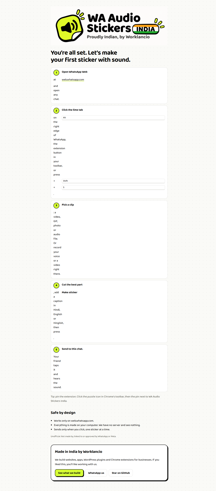
</details>

<details>
<summary><b>Install from the source code (for developers)</b></summary>

```bash
git clone https://github.com/xaviermsd/whatsapp-audio-stickers-india.git
```

Then do steps 3 to 5 above and pick the `extension` folder inside the repo.
</details>

> [!TIP]
> Already had WhatsApp Web open? Reload the tab once after installing, or just click the extension button and we
> reload it for you.

---

<a id="how-to-use"></a>

## 🚀 Make your first sticker

### 1. Open WhatsApp Web and click the lime tab

Open **[web.whatsapp.com](https://web.whatsapp.com)**, open any chat, then click the **lime tab** on the right
edge. You can also click the extension button or press **Alt + Shift + S**.

<picture>
  <source media="(prefers-color-scheme: dark)" srcset="docs/screenshots/00-launcher-dark.png">
  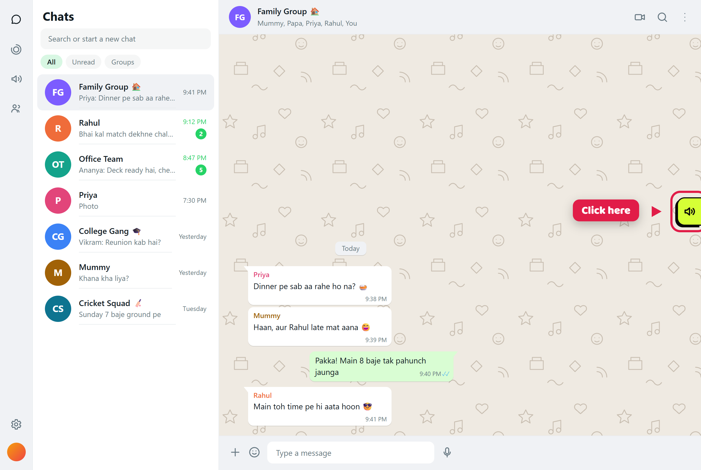
</picture>

<table>
<tr>
<td width="50%" valign="top">

### 2. Pick your clip

Drop a video, GIF, photo or audio file on the box, click to choose one, or paste with **Ctrl + V**.

No clip? Press **Record voice** or **Record video** and make one right now (up to 15 seconds).

</td>
<td width="50%">
<picture>
  <source media="(prefers-color-scheme: dark)" srcset="docs/screenshots/01-pick-dark.png">
  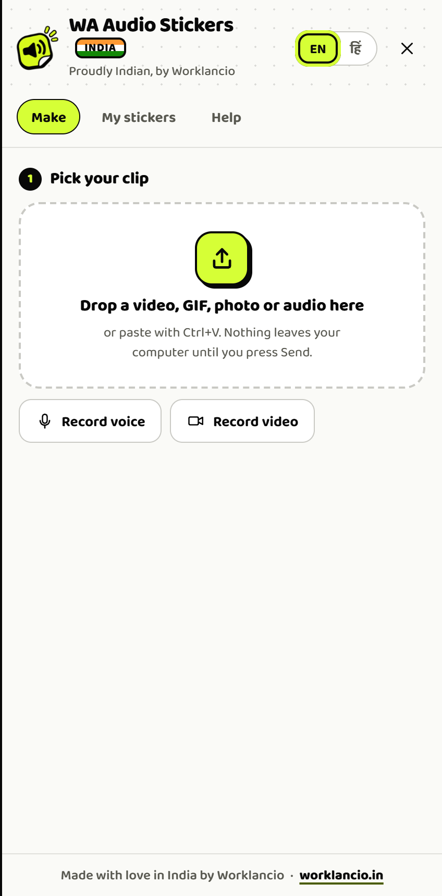
</picture>
</td>
</tr>
<tr>
<td width="50%" valign="top">

### 3. Cut and style

- Drag **Start** and **End** to keep the best part (up to 15 seconds).
- Pick a **speed**, turn on **Boomerang**, set the **volume**.
- **Make it louder** levels quiet clips. **Soft fade** removes clicks.
- **Frame:** crop to fill the square, or show the whole picture.
- Type a **caption**: `Kya baat hai!` or `क्या बात है!`
- Choose the **emoji tag** WhatsApp shows in sticker search.

</td>
<td width="50%">
<picture>
  <source media="(prefers-color-scheme: dark)" srcset="docs/screenshots/02-edit-dark.png">
  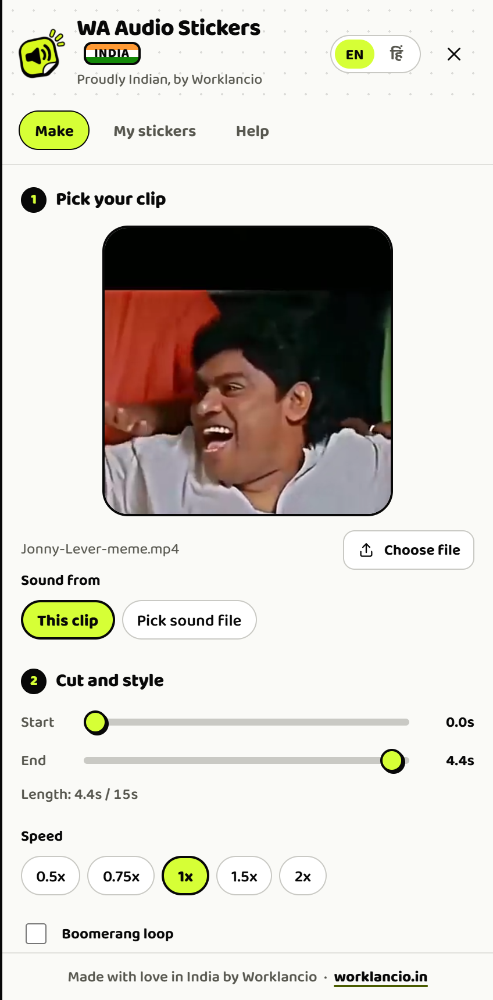
</picture>
</td>
</tr>
<tr>
<td width="50%" valign="top">

### 4. Make the sticker

Press **Make sticker**. It takes a few seconds, all on your computer. Changed your mind? **Cancel** any time.

The **size meter** shows the picture and sound against WhatsApp's 1,000 KB limits. We lower quality, frame rate
or size by ourselves if needed, so it always fits.

</td>
<td width="50%">
<picture>
  <source media="(prefers-color-scheme: dark)" srcset="docs/screenshots/04-ready-dark.png">
  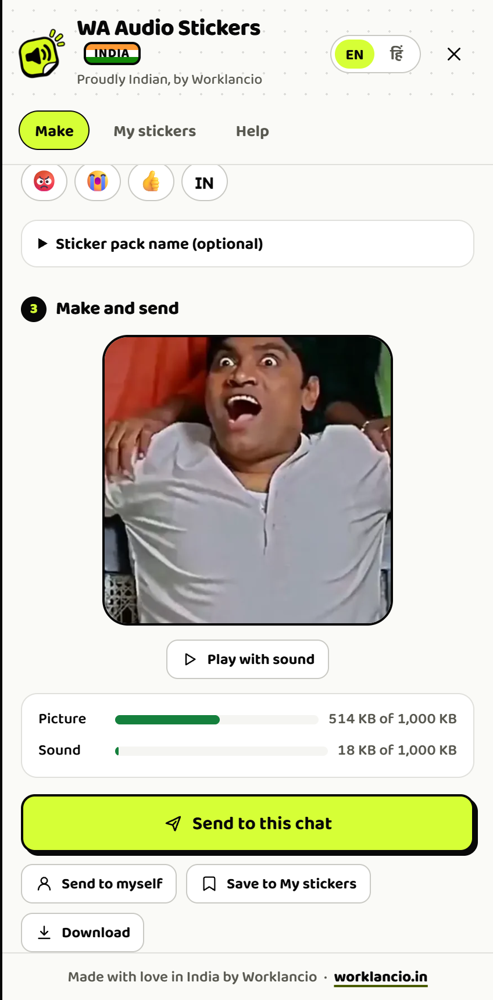
</picture>
</td>
</tr>
<tr>
<td width="50%" valign="top">

### 5. Send it

- **Send to this chat** sends it to the chat you have open.
- **Send to myself** puts it in your own "You" chat, so you can forward it anywhere from your phone.
- **Save to My stickers** keeps it for next time.
- **Download** saves the `.webp` picture and `.ogg` sound.

Your friend taps the sticker and hears the sound. 🔊

</td>
<td width="50%">
<picture>
  <source media="(prefers-color-scheme: dark)" srcset="docs/screenshots/05-sent-dark.png">
  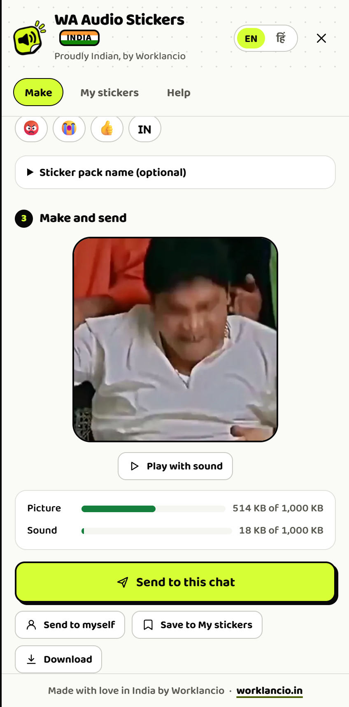
</picture>
</td>
</tr>
</table>

### In the chat

Stickers arrive like any WhatsApp sound sticker, with the speaker badge on top. Tap to hear it.

<picture>
  <source media="(prefers-color-scheme: dark)" srcset="docs/screenshots/00-chat-dark.png">
  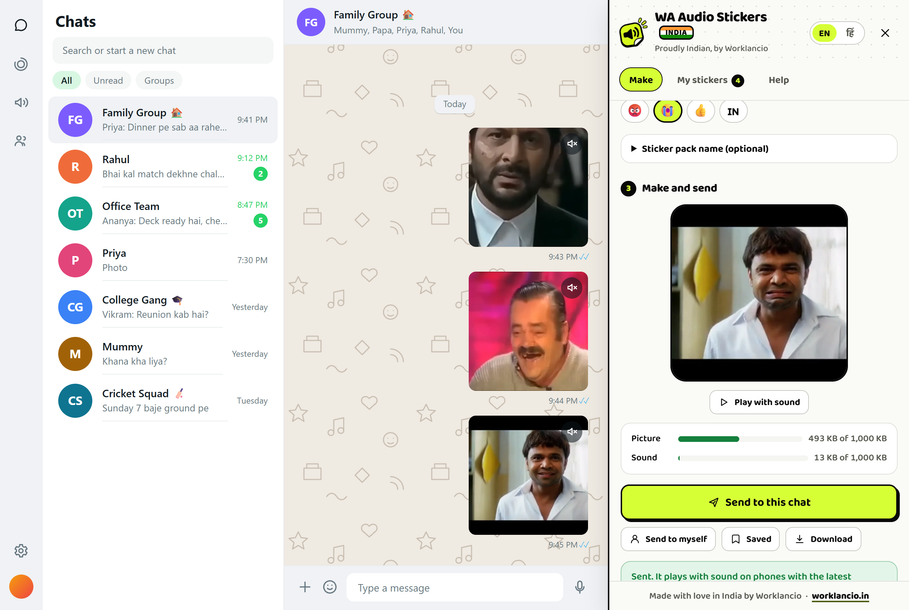
</picture>

<sub>Screenshots and demo are from our test chat page (made-up names, sending simulated), using short moments
from the clips credited in <a href="#clip-ideas">Clip ideas</a>.</sub>

---

## 🧭 Feature tour

<details>
<summary><b>📦 My stickers: your saved library</b></summary>
<br>

Save up to 60 stickers. Tap one to hear it, ⭐ to keep it on top, send it again in one click, download it or
delete it. **Export pack** saves them all as one file, and **Import pack** loads a pack a friend sent you.

<picture>
  <source media="(prefers-color-scheme: dark)" srcset="docs/screenshots/06-library-dark.png">
  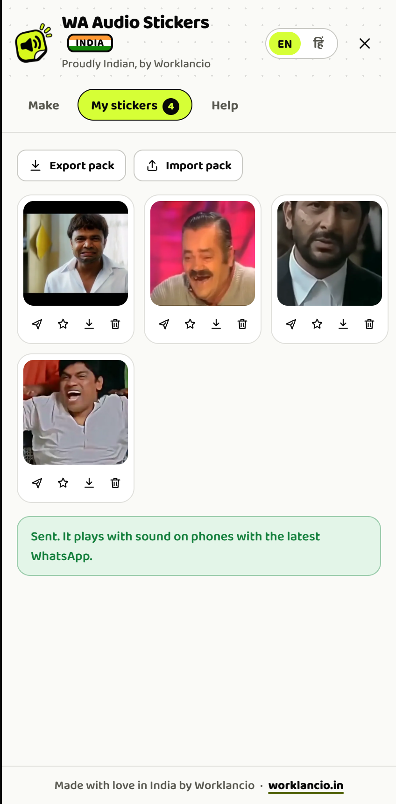
</picture>
</details>

<details>
<summary><b>🇮🇳 Hindi app and Hindi captions</b></summary>
<br>

Tap **हिं** in the top corner and every button, tip and error message switches to Hindi. Captions work in
Devanagari, English or a mix of both.

<picture>
  <source media="(prefers-color-scheme: dark)" srcset="docs/screenshots/08-hindi-dark.png">
  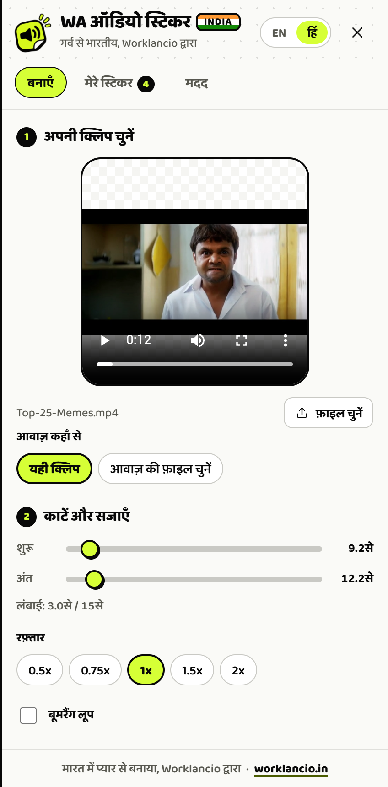
</picture>
</details>

<details>
<summary><b>🎙️ Voice stickers (audio only)</b></summary>
<br>

Record your voice or pick an audio file. With no picture, we make a moving sound wave on a lime card for you. Add a
photo (a friend's face works great) and the wave plays on top of it.
</details>

<details>
<summary><b>❓ Help tab and diagnostics</b></summary>
<br>

The Help tab has the steps, the safety notes and a **Diagnostics** button. If sending ever breaks after a WhatsApp
update, copy what it shows into a GitHub issue. It lists which WhatsApp parts we can see and your browser's
abilities. It never includes chats, names or numbers.

<picture>
  <source media="(prefers-color-scheme: dark)" srcset="docs/screenshots/07-help-dark.png">
  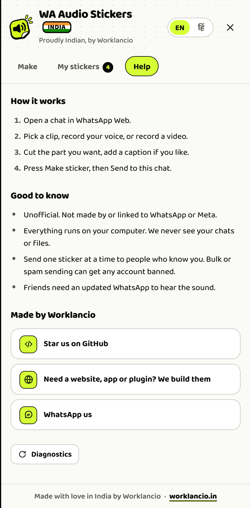
</picture>
</details>

<details>
<summary><b>🌗 Light and dark mode</b></summary>
<br>

The panel follows WhatsApp Web's theme by itself.
</details>

---

<a id="clip-ideas"></a>

## 🎞️ Clip ideas to try

Looking for funny clips? These YouTube meme compilations are a good place to start. Cut a 2 to 5 second moment,
add a caption and send. Credit and thanks to the channels below.

| Video | Channel |
|---|---|
| [Funny Memes Clip, Top 10+](https://www.youtube.com/watch?v=G3KoTo4ozEw) | [MIX LEARN](https://www.youtube.com/@MIX-LEARN) |
| [Top 20 Memes 2026](https://www.youtube.com/watch?v=YRgBuqH7Ydo) | [MIX LEARN](https://www.youtube.com/@MIX-LEARN) |
| [Top 25+ Indian Memes](https://www.youtube.com/watch?v=ZKjWZAQy_wI) | [MIX LEARN](https://www.youtube.com/@MIX-LEARN) |
| [Funny memes, comedy clip](https://www.youtube.com/watch?v=qgneC9e4EbI) | [MIX LEARN](https://www.youtube.com/@MIX-LEARN) |
| [Top 15+ Meme Clips for Editing](https://www.youtube.com/watch?v=UpvNwUUi1wY) | [MOGAR TiLE](https://www.youtube.com/@MOGARTiLE) |
| [Johnny Lever meme](https://www.youtube.com/shorts/FlZOpS5mJTk) | [STAR MEMER](https://www.youtube.com/@_STAR_MEMER) |
| [Kon hai ye, funny meme](https://www.youtube.com/shorts/YKRQoJDNULU) | [wondercomedy786](https://www.youtube.com/@wondercomedy786) |
| [Top 10 Popular Memes for Editing](https://www.youtube.com/shorts/QSBbGBYe4G8) | [Vivek Fact](https://www.youtube.com/@vivekfact187) |
| [El Risitas laugh, 5 seconds](https://www.youtube.com/watch?v=Jw9H_OdcKC8) | [Cyber Trend](https://www.youtube.com/@cybertrend4774) |

> [!NOTE]
> The extension does not download anything from YouTube. Use clips you are allowed to use, and respect the
> people in them. **Own a clip shown in our demo and want it removed?** Email
> [hello@worklancio.in](mailto:hello@worklancio.in) and we will remove it within 24 hours.

---

<a id="safe-use"></a>

## 🛡️ Safe use and privacy

| ✅ We do | ❌ We never |
|---|---|
| Work only on `web.whatsapp.com` | Read other websites |
| Make stickers on your own computer | Upload your files to any server (we have none) |
| Send only when you click Send | Send in bulk, schedule or automate |
| Send to the open chat or to yourself | Read your chats, contacts or numbers |
| Keep saved stickers in your browser | Track you, show ads or sell data |

**Please use it kindly.** Any add-on for WhatsApp Web carries some risk to your account. Send stickers to people
who know you, one at a time, and never use it for spam. Friends need an up-to-date WhatsApp to hear the sound.

Full details, and how we enforce them with tests: **[SECURITY.md](SECURITY.md)**.

---

<a id="faq"></a>

## 💬 FAQ

<details>
<summary><b>Is it free?</b></summary>
<br>Yes, completely, and open source under the MIT licence. No sign-up, no ads, no paid tier.
</details>

<details>
<summary><b>Will my friend hear the sound?</b></summary>
<br>Yes, if their WhatsApp is up to date. On Android and iPhone the sound plays when they tap the sticker. Older
WhatsApp versions show "this message is not supported" instead.
</details>

<details>
<summary><b>Can I use it on my phone?</b></summary>
<br>Not directly: it is a desktop browser extension for WhatsApp Web. But use <b>Send to myself</b>, then forward
or star the sticker from your phone, and it stays in your phone's sticker tray.
</details>

<details>
<summary><b>Does it work on Firefox or Safari?</b></summary>
<br>Not yet. We need browser features (WebCodecs Opus encoding and page-level content scripts) that today only
Chrome, Edge and Brave have.
</details>

<details>
<summary><b>How long can a sticker be?</b></summary>
<br>Up to 15 seconds. Short clips (2 to 6 seconds) look the sharpest, because WhatsApp limits each sticker to about
1 MB for the picture and 1 MB for the sound.
</details>

<details>
<summary><b>Why does it need WhatsApp Web's internal code?</b></summary>
<br>WhatsApp has no public way to send sound stickers from a computer yet. We use WhatsApp Web's own upload and
send functions, so stickers are end-to-end encrypted like any message. The downside: a WhatsApp update can break
sending until we update. Star the repo to hear about fixes.
</details>

<details>
<summary><b>Can my account get banned?</b></summary>
<br>We built it to behave like a normal person sending a sticker: one at a time, only when you click, only to the
open chat. We have no reports of bans from this kind of use, but WhatsApp does not approve any add-ons, so we
cannot promise anything. Never use it for bulk messages or spam.
</details>

<details>
<summary><b>Where are my saved stickers kept?</b></summary>
<br>In your browser's extension storage, on your computer only. Removing the extension deletes them, so use
<b>Export pack</b> to keep a backup.
</details>

---

<a id="troubleshooting"></a>

## 🛠️ Troubleshooting

<details>
<summary><b>"Manifest file is missing or unreadable"</b></summary>
<br>You picked the outer folder. Open it and pick the folder that has <code>manifest.json</code> directly inside it.
If you downloaded the zip before 27 Nov 2026, download it again: the new zip has no extra folder.
</details>

<details>
<summary><b>I don't see the lime tab</b></summary>
<br>Reload WhatsApp Web (F5). Check the extension is turned on in your extensions page. Wait until your chats have
loaded.
</details>

<details>
<summary><b>"WhatsApp is still loading"</b></summary>
<br>Wait a few seconds after your chats appear, then press Send again.
</details>

<details>
<summary><b>"WhatsApp sent the picture without sound"</b></summary>
<br>Your account may not have sound stickers switched on yet. Reload WhatsApp Web and try again after 10 seconds.
If it keeps happening, open the Help tab, press Diagnostics and send us the result in an issue.
</details>

<details>
<summary><b>"We could not read the sound in this file"</b></summary>
<br>Convert the clip to MP4 or MP3 and try again. Some MKV and AVI files use sound formats browsers cannot read.
</details>

<details>
<summary><b>"Too busy to fit the 1 MB limit"</b></summary>
<br>Cut a shorter part, or choose <b>Show whole picture</b>. Clips with lots of fast movement are bigger.
</details>

<details>
<summary><b>Microphone or camera blocked</b></summary>
<br>Click the camera or lock icon in the address bar on WhatsApp Web, allow the microphone or camera, and try
again.
</details>

<details>
<summary><b>Sending stopped working after a WhatsApp update</b></summary>
<br>Open an <a href="https://github.com/xaviermsd/whatsapp-audio-stickers-india/issues">issue</a> with the
Diagnostics output. Making stickers and downloading them still works while we fix sending.
</details>

---

<a id="how-it-works"></a>

## ⚙️ How it works

```
Your clip
  -> WebAudio cuts it, changes speed and volume, mixes to mono 48 kHz      (extension/lib/audio.js)
  -> WebCodecs encodes Opus, we write the Ogg file by hand (RFC 7845)       (extension/lib/ogg.js)
  -> Canvas draws each frame square, with your caption                     (extension/lib/frames.js)
  -> the browser's WebP encoder makes each frame, we build an animated WebP (extension/lib/webp.js)
     with WhatsApp's sticker info and the sound's SHA-256 inside
  -> quality, frame rate and size are tuned to fit 1 MB                     (extension/lib/builder.js)
  -> WhatsApp Web's own code uploads the sound, then sends the sticker      (extension/wa/sender.js)
     with the sound attached, end-to-end encrypted
```

No libraries, no WebAssembly, no server: only built-in browser features. The whole screen is driven by two small
state machines, see [docs/STATE-MACHINES.md](docs/STATE-MACHINES.md).

<details>
<summary><b>Project map</b></summary>

```text
extension/
  manifest.json        Permissions: storage only, site: web.whatsapp.com only
  background.js        Toolbar button and Alt+Shift+S open the panel
  bridge.js            The only part with extension access: saved stickers, settings, font, logo
  main.js              Starts everything inside WhatsApp Web
  state/               stickerJob.js and recorder.js state machines
  lib/                 ogg, webp, audio, frames, builder, i18n (English and Hindi)
  wa/sender.js         Talks to WhatsApp Web: turns on sound stickers, uploads, sends, cooldown
  ui/                  panel.js (the panel), styles.js, icons.js, store.js
  fonts/               Baloo 2 (SIL Open Font License)
  welcome.html         Shown after install
tests/                 Node tests: state machines, file formats, security guards
dev/                   Test page, screenshots, demo recorder, brand assets, real-WhatsApp check
docs/                  Screenshots, brand files, state machines, logo brief
brand/final/           Designer's original logo files (never edited)
```
</details>

<details>
<summary><b>Develop and test</b></summary>

Needs Node 20 or newer.

```bash
npm install          # only dev tools (Playwright core for screenshots)
npm test             # state machines, Ogg and WebP writers, security guards
npm run dev          # test page at http://localhost:4417/dev/harness.html (sending is simulated)
npm run shots        # README screenshots, light and dark
node dev/demo.mjs    # demo GIF
node dev/extension-check.mjs   # loads the real extension on real web.whatsapp.com (login page)
npm run zip          # release zip
```

Rules we keep: no network calls, no new permissions, no `innerHTML`, no long dashes in any text. The security
tests fail if any of these slip in.
</details>

---

<a id="hindi"></a>

## 🇮🇳 हिंदी में

**WA ऑडियो स्टिकर इंडिया** से आप किसी भी वीडियो, GIF, फ़ोटो या अपनी आवाज़ से **आवाज़ वाले WhatsApp स्टिकर**
बना सकते हैं और सीधे WhatsApp Web से भेज सकते हैं।

1. ऊपर दिए **Releases** से ZIP डाउनलोड करें और अनज़िप करें।
2. Chrome में `chrome://extensions` खोलें, **Developer mode** चालू करें, **Load unpacked** से फ़ोल्डर चुनें।
3. **web.whatsapp.com** खोलें, कोई चैट खोलें, दाईं तरफ़ **लाइम रंग का टैब** दबाएँ।
4. क्लिप चुनें या अपनी आवाज़ रिकॉर्ड करें, हिस्सा काटें, कैप्शन लिखें (हिंदी या Hinglish)।
5. **स्टिकर बनाएँ** दबाएँ, फिर **इस चैट में भेजें**।

ऐप को हिंदी में चलाने के लिए ऊपर **हिं** दबाएँ। सब कुछ आपके कंप्यूटर पर ही बनता है, हम कुछ नहीं देखते।
एक बार में एक स्टिकर, जान पहचान वालों को ही भेजें।

---

## 🤝 Contributing

Ideas, bug reports and pull requests are welcome.

- **Found a bug?** Open an [issue](https://github.com/xaviermsd/whatsapp-audio-stickers-india/issues) with the
  Diagnostics output from the Help tab.
- **Want a feature?** Tell us in an issue first, so we can plan it together.
- **Translating?** Copy the `en` block in `extension/lib/i18n.js`. We would love Gujarati, Marathi, Tamil,
  Telugu, Bengali, Portuguese and Indonesian next.

Please keep the rules from [SECURITY.md](SECURITY.md): no network calls, no new permissions.

---

## 🙏 Credits

- Built from scratch by the **[Worklancio](https://www.worklancio.in)** team. Built by Harsh Prajapati.
- Font: [Baloo 2](https://github.com/EkType/Baloo2) by Ek Type, SIL Open Font License.
- Inspired by the open-source WhatsApp audio sticker community. No code was copied from other projects.

WhatsApp is a trademark of WhatsApp LLC. This project is not affiliated with, made by or endorsed by WhatsApp
or Meta.

---

<a id="worklancio"></a>

## 💚 Made by Worklancio

<div align="center">

<a href="https://www.worklancio.in/?utm_source=github&utm_medium=readme&utm_campaign=wa-audio-stickers">
  <picture>
    <source media="(prefers-color-scheme: dark)" srcset="docs/brand/worklancio-on-dark.png">
    
  </picture>
</a>

### Liked this? We build websites, apps and tools like it for businesses.

WordPress, WooCommerce and Shopify stores, custom web apps and dashboards, Chrome extensions, AI features, SEO
and website care. From India, for clients worldwide.

<a href="https://www.worklancio.in/services?utm_source=github&utm_medium=readme&utm_campaign=wa-audio-stickers"></a>
<a href="https://wa.me/919898528376?text=Hi%20Worklancio%2C%20I%20saw%20WA%20Audio%20Stickers%20on%20GitHub"></a>
<a href="mailto:hello@worklancio.in?subject=Project%20enquiry%20from%20GitHub"></a>

**If this made you smile, please ⭐ star the repo and share it with a friend.** It helps more people find it.

<sub>Proudly Indian. Made with love by Worklancio. Built by Harsh Prajapati.</sub>

</div>
