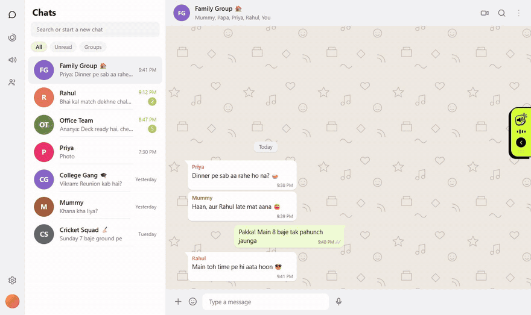
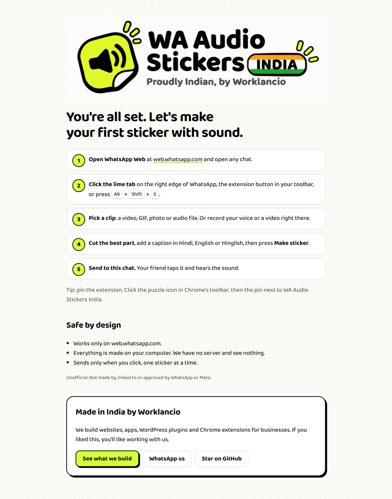
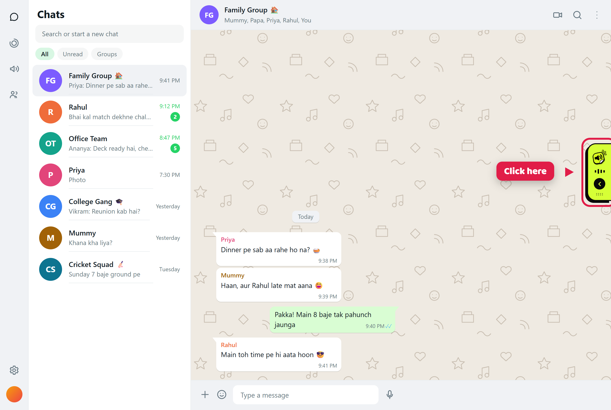
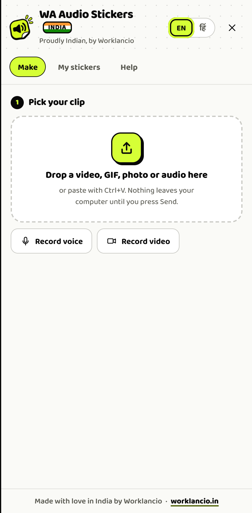
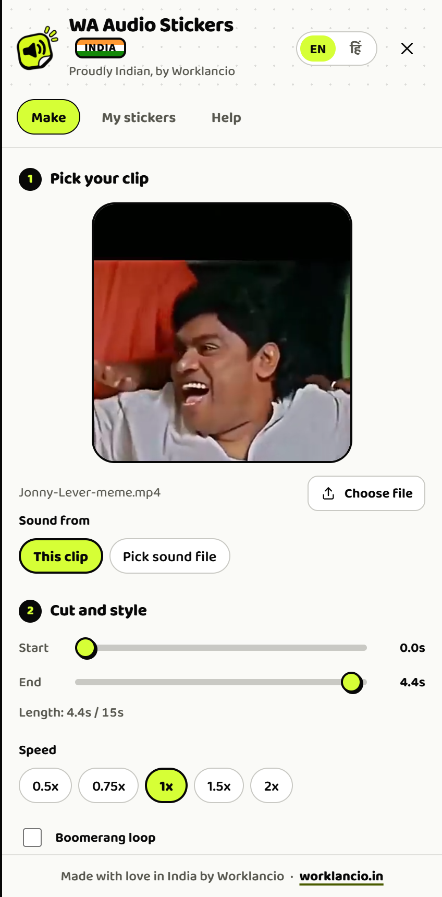
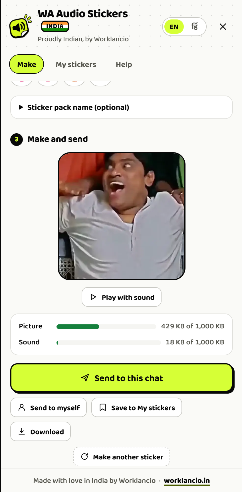
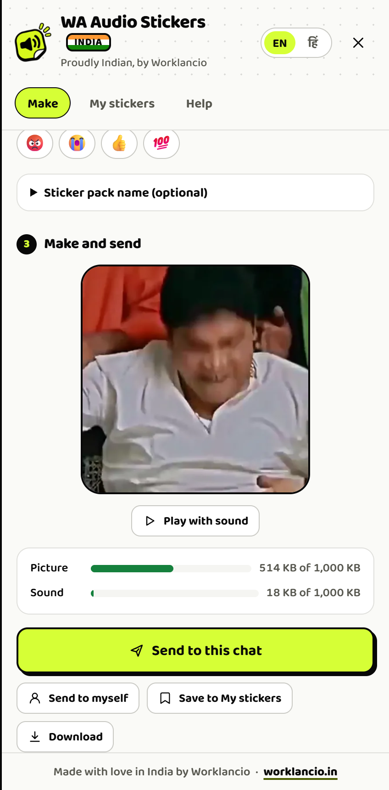

<div align="center">

<a href="https://github.com/xaviermsd/whatsapp-audio-stickers-india">
  <picture>
    <source media="(prefers-color-scheme: dark)" srcset="../brand/banner-dark.png">
    
  </picture>
</a>

### Crea stickers de WhatsApp con sonido a partir de cualquier video, GIF, foto o tu propia voz.
### Gratis. Privado. Funciona en tu navegador. Hecho con orgullo en la India.

[](https://github.com/xaviermsd/whatsapp-audio-stickers-india/releases/latest)
[](../../LICENSE)
[](https://github.com/xaviermsd/whatsapp-audio-stickers-india/stargazers)


[English](../../README.md) · [हिंदी](README.hi.md) · [Português](README.pt-BR.md) · **[Español](README.es.md)** · [Bahasa Indonesia](README.id.md)

<br>



</div>

---

## ✨ Qué hace

WA Audio Stickers India agrega una pequeña pestaña verde lima a **WhatsApp Web**. Haz clic en ella, suelta un clip,
recorta la parte graciosa, ponle un texto y presiona **"Send to this chat"**. Tu amigo recibe un sticker que suena
cuando lo toca, en Android, iPhone y WhatsApp Web.

- 🎬 **Cualquier clip:** MP4, WebM, MOV, GIF, PNG, JPG, MP3, M4A, WAV, OGG.
- 🎙️ **Graba ahí mismo en WhatsApp:** tu voz o un video selfie.
- ✂️ **Recorta sobre la forma de onda, escucha la parte antes, acelera, pon en cámara lenta, haz un bumerán,** sube el volumen y agrega entrada y salida suaves.
- 🔤 **Textos en hindi, inglés o hinglish,** con una fuente devanagari de verdad.
- 📦 **Biblioteca "My stickers":** guarda tus favoritos y vuelve a enviarlos con un clic.
- 🔒 **100% en tu computadora.** Sin servidor, sin registro, sin rastreo.

> [!IMPORTANT]
> Esta es una herramienta **no oficial**. No la hizo WhatsApp ni Meta, no tiene relación con ellos y no está aprobada
> por ellos. Lee [Uso seguro](#safe-use) antes de empezar.

> [!NOTE]
> La app se muestra en inglés (y en hindi). Por eso aquí dejamos los nombres de los botones en inglés, tal como los
> vas a ver en pantalla.

---

## 🆕 Qué hay de nuevo en nuestra versión

Revisamos las herramientas de código abierto para stickers con sonido que existen hoy (noviembre de 2026) y creamos
la nuestra desde cero, con funciones que ninguna de ellas tiene:

| | Función | Por qué importa |
|:-:|---|---|
| 🆕 | **Grabar voz** en el panel | Haz un sticker de voz en 5 segundos. No necesitas ningún archivo. |
| 🆕 | **Grabar video** con tu cámara web | Tu propio sticker de reacción, con sonido, al instante. |
| 🆕 | **Animación para stickers de voz** | Un audio solo se convierte en una onda de sonido en movimiento sobre una tarjeta verde lima, o sobre tu propia foto. |
| 🆕 | **Textos en hindi, inglés y hinglish** | Letras gruesas con contorno en Baloo 2, que tiene letras devanagari reales. |
| 🆕 | **App en hindi e inglés** | Cambia con un toque: EN o हिं. |
| 🆕 | **Barra de recorte con forma de onda** | Mira el sonido, arrastra dos manijas, escucha solo esa parte o escribe los tiempos exactos. |
| 🆕 | **Control de velocidad** de 0.5x a 2x | Drama en cámara lenta o comedia con voz de ardilla. |
| 🆕 | **Bumerán** | Se reproduce hacia adelante y luego hacia atrás. |
| 🆕 | **Biblioteca "My stickers"** | Hasta 60 stickers guardados, favoritos arriba, reenvío con un clic. |
| 🆕 | **Exportar e importar paquetes** | Comparte un paquete completo de stickers con tus amigos en un solo archivo. |
| 🆕 | **Medidor de tamaño en vivo** | Mira exactamente qué tan cerca estás de los límites de 1 MB de WhatsApp. |
| 🆕 | **Límites de seguridad incluidos** | Un envío a la vez, solo al chat abierto, con una pequeña pausa. |
| ✅ | Ajuste automático a los límites de WhatsApp | La calidad, los cuadros por segundo y el tamaño se ajustan por ti, para que siempre se pueda enviar. |
| ✅ | Nombre del paquete y autor | Se ven debajo del sticker en el teléfono de tu amigo. |

---

## 📥 Instálalo en 2 minutos

Funciona en **Chrome, Edge y Brave** en Windows, Mac y Linux (versión 116 o más nueva).

1. **Descarga** el archivo más reciente `whatsapp-audio-stickers-india-vX.Y.Z.zip` desde
   **[Releases](https://github.com/xaviermsd/whatsapp-audio-stickers-india/releases/latest)**.
2. **Descomprímelo**. Vas a tener una carpeta llamada `whatsapp-audio-stickers-india`.
3. Abre la página de extensiones de tu navegador:
   - Chrome: `chrome://extensions`
   - Edge: `edge://extensions`
   - Brave: `brave://extensions`
4. Activa el **Modo de desarrollador** ("Developer mode"). Está arriba a la derecha en Chrome y Brave, y del lado
   izquierdo en Edge.
5. Haz clic en **Cargar descomprimida** ("Load unpacked") y elige la carpeta que descomprimiste.
6. Se abre una página de bienvenida. ¡Listo! Fija la extensión: haz clic en el ícono de rompecabezas 🧩 y luego en el
   pin 📌.

<details>
<summary><b>Ver la página de bienvenida</b></summary>
<br>

</details>

<details>
<summary><b>Instalar desde el código fuente (para desarrolladores)</b></summary>

```bash
git clone https://github.com/xaviermsd/whatsapp-audio-stickers-india.git
```

Luego sigue los pasos 3 a 5 de arriba y elige la carpeta `extension` dentro del repositorio.
</details>

> [!TIP]
> ¿Ya tenías WhatsApp Web abierto? Recarga la pestaña una vez después de instalar, o simplemente haz clic en el botón
> de la extensión y nosotros la recargamos por ti.

---

## 🚀 Crea tu primer sticker

### 1. Abre WhatsApp Web y haz clic en la pestaña verde lima

Abre **[web.whatsapp.com](https://web.whatsapp.com)**, entra a cualquier chat y haz clic en la **pestaña verde lima**
del borde derecho. También puedes hacer clic en el botón de la extensión o presionar **Alt + Shift + S**.

<picture>
  <source media="(prefers-color-scheme: dark)" srcset="../screenshots/00-launcher-dark.png">
  
</picture>

<table>
<tr>
<td width="50%" valign="top">

### 2. Elige tu clip

Suelta un video, GIF, foto o audio en el recuadro, haz clic para elegir un archivo o pégalo con **Ctrl + V**.

¿No tienes clip? Presiona **"Record voice"** (grabar voz) o **"Record video"** (grabar video) y haz uno ahora mismo
(hasta 15 segundos).

</td>
<td width="50%">
<picture>
  <source media="(prefers-color-scheme: dark)" srcset="../screenshots/01-pick-dark.png">
  
</picture>
</td>
</tr>
<tr>
<td width="50%" valign="top">

### 3. Recorta y dale estilo

- Arrastra las dos manijas lima sobre la **forma de onda** para quedarte con la mejor parte (hasta 15 segundos). Se ve dónde está lo más fuerte.
- Presiona **"Play this part"** para escuchar solo esa parte, o escribe los tiempos exactos en **"From"** y **"To"**.
- Elige la velocidad en **"Speed"**, activa **"Boomerang loop"** y ajusta el **"Volume"**.
- **"Make it louder"** empareja los clips que se oyen bajito. **"Soft fade in and out"** quita los chasquidos.
- **"Frame":** recorta para llenar el cuadrado o muestra la imagen completa.
- Escribe un texto en **"Caption"**: `Kya baat hai!` o `क्या बात है!`
- Elige el **"Emoji tag"**, el emoji que WhatsApp usa en la búsqueda de stickers.

</td>
<td width="50%">
<picture>
  <source media="(prefers-color-scheme: dark)" srcset="../screenshots/02-edit-dark.png">
  
</picture>
</td>
</tr>
<tr>
<td width="50%" valign="top">

### 4. Crea el sticker

Presiona **"Make sticker"**. Tarda unos segundos, todo en tu computadora. ¿Cambiaste de idea? Presiona **"Cancel"**
cuando quieras.

El **medidor de tamaño** compara la imagen y el sonido con los límites de 1,000 KB de WhatsApp. Si hace falta,
nosotros mismos bajamos la calidad, los cuadros por segundo o el tamaño, para que siempre quepa.

</td>
<td width="50%">
<picture>
  <source media="(prefers-color-scheme: dark)" srcset="../screenshots/04-ready-dark.png">
  
</picture>
</td>
</tr>
<tr>
<td width="50%" valign="top">

### 5. Envíalo

- **"Send to this chat"** lo envía al chat que tienes abierto.
- **"Send to myself"** lo manda a tu propio chat "Tú", para que lo reenvíes a donde quieras desde tu teléfono.
- **"Save to My stickers"** lo guarda para la próxima vez.
- **"Download"** guarda la imagen `.webp` y el sonido `.ogg`.

Tu amigo toca el sticker y escucha el sonido. 🔊

</td>
<td width="50%">
<picture>
  <source media="(prefers-color-scheme: dark)" srcset="../screenshots/05-sent-dark.png">
  
</picture>
</td>
</tr>
</table>

---

<a id="safe-use"></a>

## 🛡️ Uso seguro y privacidad

| ✅ Lo que sí hacemos | ❌ Lo que nunca hacemos |
|---|---|
| Funcionamos solo en `web.whatsapp.com` | Leer otros sitios web |
| Creamos los stickers en tu propia computadora | Subir tus archivos a algún servidor (no tenemos ninguno) |
| Enviamos solo cuando haces clic para enviar | Enviar en masa, programar envíos o automatizarlos |
| Enviamos al chat abierto o a ti mismo | Leer tus chats, contactos o números |
| Guardamos tus stickers en tu navegador | Rastrearte, mostrarte anuncios o vender datos |

**Úsalo con buena onda.** Cualquier complemento para WhatsApp Web tiene algo de riesgo para tu cuenta. Envía stickers
a personas que te conocen, uno a la vez, y nunca lo uses para spam. Tus amigos necesitan WhatsApp actualizado para
escuchar el sonido.

Todos los detalles, y cómo lo garantizamos con pruebas: **[SECURITY.md](../../SECURITY.md)** (en inglés).

---

## 💬 Preguntas frecuentes

<details>
<summary><b>¿Es gratis?</b></summary>
<br>Sí, totalmente, y es de código abierto con licencia MIT. Sin registro, sin anuncios, sin plan de pago.
</details>

<details>
<summary><b>¿Mi amigo va a escuchar el sonido?</b></summary>
<br>Sí, si tiene WhatsApp actualizado. En Android y iPhone el sonido se reproduce cuando toca el sticker. Las versiones
viejas de WhatsApp muestran un aviso de que el mensaje no es compatible.
</details>

<details>
<summary><b>¿Lo puedo usar en mi teléfono?</b></summary>
<br>No directamente: es una extensión de navegador de computadora para WhatsApp Web. Pero usa <b>"Send to myself"</b>,
luego reenvía el sticker o márcalo como favorito desde tu teléfono, y se queda en tu bandeja de stickers.
</details>

<details>
<summary><b>¿Funciona en Firefox o Safari?</b></summary>
<br>Todavía no. Necesitamos funciones del navegador (codificación Opus con WebCodecs y content scripts a nivel de
página) que hoy solo tienen Chrome, Edge y Brave.
</details>

<details>
<summary><b>¿Cuánto puede durar un sticker?</b></summary>
<br>Hasta 15 segundos. Los clips cortos (de 2 a 6 segundos) se ven más nítidos, porque WhatsApp limita cada sticker a
cerca de 1 MB para la imagen y 1 MB para el sonido.
</details>

<details>
<summary><b>¿Por qué necesita el código interno de WhatsApp Web?</b></summary>
<br>WhatsApp todavía no tiene una forma pública de enviar stickers con sonido desde la computadora. Usamos las propias
funciones de carga y envío de WhatsApp Web, así que los stickers van cifrados de extremo a extremo como cualquier
mensaje. La desventaja: una actualización de WhatsApp puede romper el envío hasta que nosotros actualicemos. Dale una
estrella al repositorio para enterarte de los arreglos.
</details>

<details>
<summary><b>¿Me pueden bloquear la cuenta?</b></summary>
<br>Lo hicimos para que se comporte como una persona normal enviando un sticker: uno a la vez, solo cuando haces clic,
solo al chat abierto. No tenemos reportes de bloqueos por este tipo de uso, pero WhatsApp no aprueba ningún
complemento, así que no podemos prometer nada. Nunca lo uses para mensajes masivos o spam.
</details>

<details>
<summary><b>¿Dónde se guardan mis stickers?</b></summary>
<br>En el almacenamiento de extensiones de tu navegador, solo en tu computadora. Si quitas la extensión se borran, así
que usa <b>"Export pack"</b> para tener un respaldo.
</details>

---

## 🛠️ Solución de problemas

<details>
<summary><b>No veo la pestaña verde lima</b></summary>
<br>Recarga WhatsApp Web (F5). Revisa que la extensión esté activada en tu página de extensiones. Espera a que carguen
tus chats.
</details>

<details>
<summary><b>"WhatsApp is still loading" (WhatsApp todavía está cargando)</b></summary>
<br>Espera unos segundos después de que aparezcan tus chats y vuelve a enviar.
</details>

<details>
<summary><b>"WhatsApp sent the picture without sound" (WhatsApp envió la imagen sin sonido)</b></summary>
<br>Puede que tu cuenta todavía no tenga activados los stickers con sonido. Recarga WhatsApp Web y vuelve a intentarlo
después de 10 segundos. Si sigue pasando, abre la pestaña "Help", presiona "Diagnostics" y envíanos el resultado en
un issue.
</details>

<details>
<summary><b>"We could not read the sound in this file" (no pudimos leer el sonido de este archivo)</b></summary>
<br>Convierte el clip a MP4 o MP3 y vuelve a intentarlo. Algunos archivos MKV y AVI usan formatos de sonido que los
navegadores no pueden leer.
</details>

<details>
<summary><b>"Too busy to fit the 1 MB limit" (demasiado movimiento para caber en 1 MB)</b></summary>
<br>Recorta una parte más corta o elige <b>"Show whole picture"</b>. Los clips con mucho movimiento rápido pesan más.
</details>

<details>
<summary><b>Micrófono o cámara bloqueados</b></summary>
<br>En WhatsApp Web, haz clic en el ícono de cámara o de candado en la barra de direcciones, permite el micrófono o la
cámara y vuelve a intentarlo.
</details>

<details>
<summary><b>El envío dejó de funcionar después de una actualización de WhatsApp</b></summary>
<br>Abre un <a href="https://github.com/xaviermsd/whatsapp-audio-stickers-india/issues">issue</a> con el resultado de
Diagnostics. Crear stickers y descargarlos sigue funcionando mientras arreglamos el envío.
</details>

---

## 💚 Hecho por Worklancio

<div align="center">

<a href="https://www.worklancio.in/?utm_source=github&utm_medium=readme&utm_campaign=wa-audio-stickers">
  <picture>
    <source media="(prefers-color-scheme: dark)" srcset="../brand/worklancio-on-dark.png">
    
  </picture>
</a>

### ¿Te gustó? Creamos sitios web, apps y herramientas como esta para empresas.

Tiendas en WordPress, WooCommerce y Shopify, apps web y paneles a medida, extensiones para Chrome, funciones con IA,
SEO y mantenimiento de sitios web. Desde la India, para clientes de todo el mundo.

<a href="https://www.worklancio.in/services?utm_source=github&utm_medium=readme&utm_campaign=wa-audio-stickers"></a>
<a href="https://wa.me/919898528376?text=Hi%20Worklancio%2C%20I%20saw%20WA%20Audio%20Stickers%20on%20GitHub"></a>
<a href="mailto:hello@worklancio.in?subject=Project%20enquiry%20from%20GitHub"></a>

**Si esto te sacó una sonrisa, dale una ⭐ estrella al repositorio y compártelo con un amigo.** Así más gente lo
encuentra.

<sub>Orgullosamente indio. Hecho con cariño por Worklancio. Built by Harsh Prajapati.</sub>

</div>

---

Los detalles para desarrolladores (cómo funciona, estructura del proyecto, pruebas y cómo contribuir) están en el [README en inglés](../../README.md).

<sub>WhatsApp is a trademark of WhatsApp LLC. This project is not affiliated with, made by or endorsed by WhatsApp or Meta.</sub>
