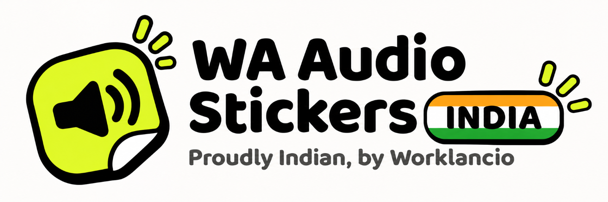
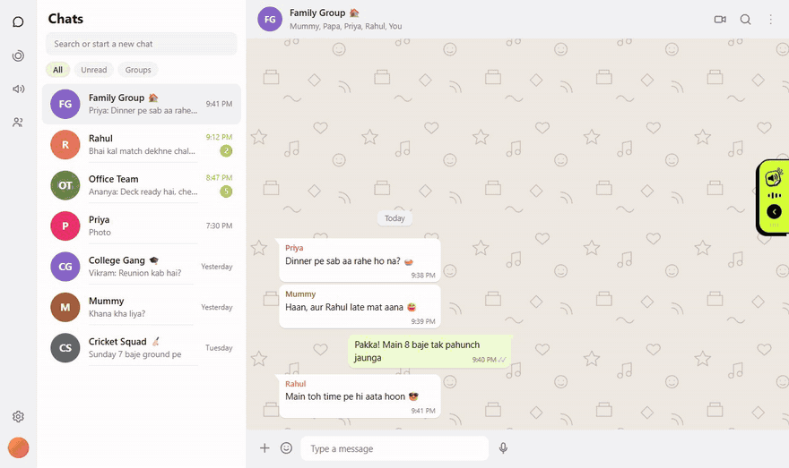
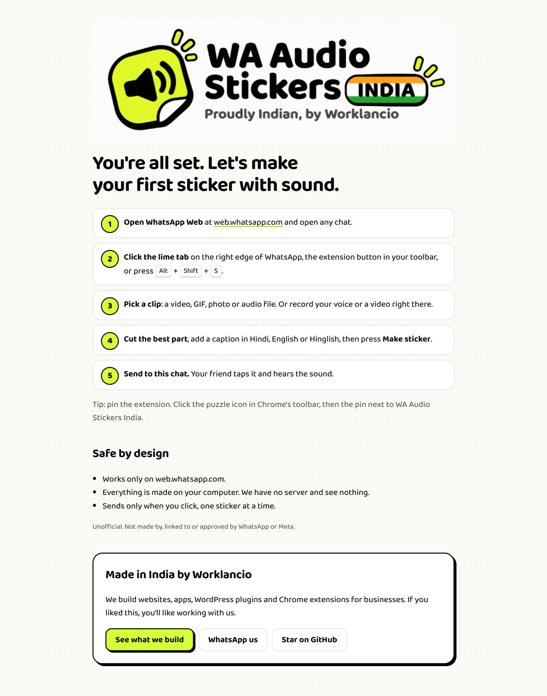
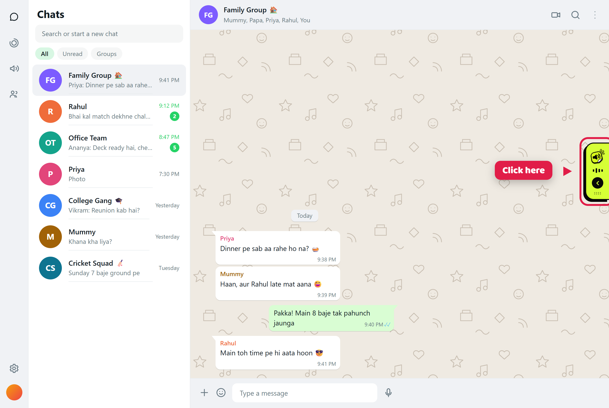
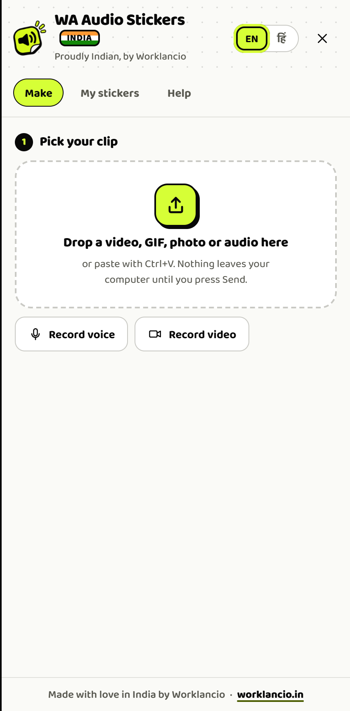
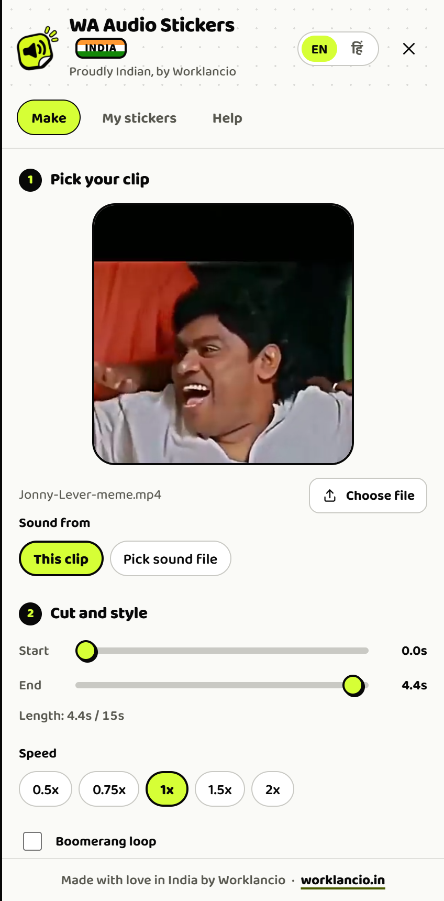
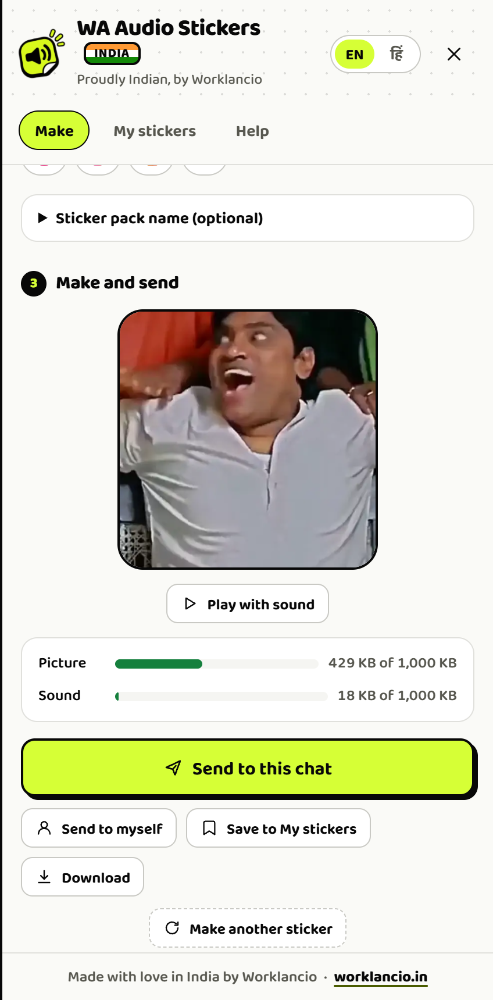
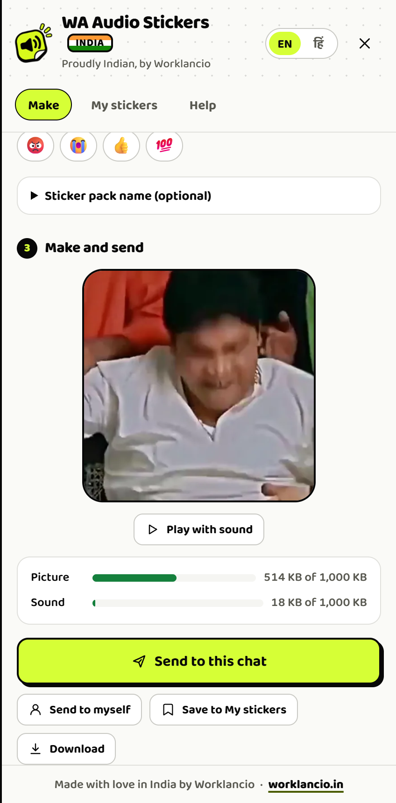

<div align="center">

<a href="https://github.com/xaviermsd/whatsapp-audio-stickers-india">
  <picture>
    <source media="(prefers-color-scheme: dark)" srcset="../brand/banner-dark.png">
    
  </picture>
</a>

### किसी भी वीडियो, GIF, फ़ोटो या अपनी आवाज़ से ऐसे WhatsApp स्टिकर बनाएँ जिनमें आवाज़ भी बजे।
### फ़्री। प्राइवेट। आपके ब्राउज़र में चलता है। गर्व से भारत में बना।

[](https://github.com/xaviermsd/whatsapp-audio-stickers-india/releases/latest)
[](../../LICENSE)
[](https://github.com/xaviermsd/whatsapp-audio-stickers-india/stargazers)


[English](../../README.md) · **[हिंदी](README.hi.md)** · [Português](README.pt-BR.md) · [Español](README.es.md) · [Bahasa Indonesia](README.id.md)

<br>



</div>

---

## ✨ यह क्या करता है

WA ऑडियो स्टिकर इंडिया **WhatsApp Web** में एक छोटा लाइम रंग का टैब जोड़ता है। उस पर क्लिक करें, क्लिप डालें,
मज़ेदार हिस्सा काटें, कैप्शन लिखें और **इस चैट में भेजें** दबाएँ। आपके दोस्त को ऐसा स्टिकर मिलता है जो टैप करते ही
आवाज़ के साथ बजता है, Android, iPhone और WhatsApp Web तीनों पर।

- 🎬 **कोई भी क्लिप:** MP4, WebM, MOV, GIF, PNG, JPG, MP3, M4A, WAV, OGG।
- 🎙️ **WhatsApp के अंदर ही रिकॉर्ड करें:** अपनी आवाज़, या सेल्फ़ी वीडियो।
- ✂️ **वेवफ़ॉर्म पर काटें, वह हिस्सा पहले सुनें, तेज़ करें, धीमा करें, बूमरैंग बनाएँ,** आवाज़ तेज़ करें, धीरे शुरू और धीरे खत्म करें।
- 🔤 **हिंदी, English या Hinglish में कैप्शन,** सही देवनागरी फ़ॉन्ट में।
- 📦 **मेरे स्टिकर लाइब्रेरी:** पसंदीदा स्टिकर रखें और एक क्लिक में दोबारा भेजें।
- 🔒 **100% आपके कंप्यूटर पर।** कोई सर्वर नहीं, कोई साइन-अप नहीं, कोई ट्रैकिंग नहीं।

> [!IMPORTANT]
> यह एक **अनऑफ़िशियल** टूल है। इसे WhatsApp या Meta ने नहीं बनाया है, यह उनसे जुड़ा नहीं है और उन्होंने इसे मंज़ूरी
> नहीं दी है। शुरू करने से पहले [सुरक्षित इस्तेमाल](#safe-use) ज़रूर पढ़ें।

---

## 🆕 हमारे वर्शन में नया क्या है

हमने आज (नवंबर 2026) मौजूद ओपन-सोर्स ऑडियो स्टिकर टूल देखे और अपना टूल शुरू से बनाया, ऐसे फ़ीचर के साथ जो उनमें
से किसी में नहीं हैं:

| | फ़ीचर | क्यों काम का है |
|:-:|---|---|
| 🆕 | पैनल में **आवाज़ रिकॉर्ड करें** | 5 सेकंड में आवाज़ वाला स्टिकर। कोई फ़ाइल नहीं चाहिए। |
| 🆕 | वेबकैम से **वीडियो रिकॉर्ड करें** | अपना रिएक्शन स्टिकर, आवाज़ के साथ, तुरंत। |
| 🆕 | **आवाज़ वाले स्टिकर का एनिमेशन** | सिर्फ़ ऑडियो हो तो लाइम कार्ड पर, या आपकी फ़ोटो के ऊपर, चलती हुई साउंड वेव बन जाती है। |
| 🆕 | **हिंदी, English और Hinglish कैप्शन** | Baloo 2 फ़ॉन्ट में मोटे, आउटलाइन वाले अक्षर, असली देवनागरी के साथ। |
| 🆕 | **ऐप हिंदी और English में** | एक टैप में बदलें: EN या हिं। |
| 🆕 | **वेवफ़ॉर्म ट्रिम बार** | आवाज़ देखें, दो हैंडल खींचें, सिर्फ़ वह हिस्सा सुनें या सही समय लिखें। |
| 🆕 | **रफ़्तार कंट्रोल** 0.5x से 2x | स्लो-मो ड्रामा या चिपमंक जैसी कॉमेडी। |
| 🆕 | **बूमरैंग लूप** | पहले आगे चलता है, फिर पीछे। |
| 🆕 | **मेरे स्टिकर लाइब्रेरी** | 60 तक स्टिकर रखें, पसंदीदा सबसे ऊपर, एक क्लिक में दोबारा भेजें। |
| 🆕 | **पैक एक्सपोर्ट और इम्पोर्ट** | पूरा स्टिकर पैक एक फ़ाइल में दोस्तों को भेजें। |
| 🆕 | **लाइव साइज़ मीटर** | देखें कि आप WhatsApp की 1 MB सीमा के कितने पास हैं। |
| 🆕 | **सुरक्षा सीमाएँ पहले से** | एक बार में एक स्टिकर, सिर्फ़ खुली चैट में, थोड़े अंतर के साथ। |
| ✅ | WhatsApp की सीमा में अपने आप फ़िट | क्वालिटी, फ़्रेम रेट और साइज़ आपके लिए सेट हो जाते हैं, ताकि स्टिकर हमेशा भेजा जा सके। |
| ✅ | स्टिकर पैक का नाम और बनाने वाला | दोस्त के फ़ोन पर स्टिकर के नीचे दिखता है। |

---

## 📥 2 मिनट में इंस्टॉल करें

यह Windows, Mac और Linux पर **Chrome, Edge और Brave** (वर्शन 116 या नया) में चलता है।

1. **[Releases](https://github.com/xaviermsd/whatsapp-audio-stickers-india/releases/latest)** से सबसे नई
   `whatsapp-audio-stickers-india-vX.Y.Z.zip` फ़ाइल **डाउनलोड** करें।
2. उसे **अनज़िप** करें। आपको `whatsapp-audio-stickers-india` नाम का फ़ोल्डर मिलेगा।
3. अपने ब्राउज़र का एक्सटेंशन पेज खोलें:
   - Chrome: `chrome://extensions`
   - Edge: `edge://extensions`
   - Brave: `brave://extensions`
4. **Developer mode** चालू करें (Chrome और Brave में ऊपर दाईं तरफ़, Edge में बाईं तरफ़)।
5. **Load unpacked** पर क्लिक करें और अनज़िप किया हुआ फ़ोल्डर चुनें।
6. एक वेलकम पेज खुलेगा। हो गया! एक्सटेंशन को पिन कर लें: पज़ल आइकन 🧩 दबाएँ, फिर पिन 📌।

<details>
<summary><b>वेलकम पेज दिखाएँ</b></summary>
<br>

</details>

<details>
<summary><b>सोर्स कोड से इंस्टॉल करें (डेवलपर के लिए)</b></summary>

```bash
git clone https://github.com/xaviermsd/whatsapp-audio-stickers-india.git
```

फिर ऊपर के स्टेप 3 से 5 करें और रिपो के अंदर वाला `extension` फ़ोल्डर चुनें।
</details>

> [!TIP]
> WhatsApp Web पहले से खुला था? इंस्टॉल के बाद टैब एक बार रीलोड करें, या बस एक्सटेंशन का बटन दबाएँ, हम आपके लिए
> रीलोड कर देंगे।

---

## 🚀 अपना पहला स्टिकर बनाएँ

### 1. WhatsApp Web खोलें और लाइम टैब दबाएँ

**[web.whatsapp.com](https://web.whatsapp.com)** खोलें, कोई भी चैट खोलें, फिर दाईं तरफ़ किनारे पर **लाइम रंग का टैब**
दबाएँ। आप एक्सटेंशन का बटन भी दबा सकते हैं या **Alt + Shift + S** दबा सकते हैं।

<picture>
  <source media="(prefers-color-scheme: dark)" srcset="../screenshots/00-launcher-dark.png">
  
</picture>

<table>
<tr>
<td width="50%" valign="top">

### 2. अपनी क्लिप चुनें

वीडियो, GIF, फ़ोटो या ऑडियो फ़ाइल बॉक्स पर छोड़ें, क्लिक करके चुनें, या **Ctrl + V** से पेस्ट करें।

क्लिप नहीं है? **आवाज़ रिकॉर्ड करें** या **वीडियो रिकॉर्ड करें** दबाएँ और अभी बना लें (15 सेकंड तक)।

</td>
<td width="50%">
<picture>
  <source media="(prefers-color-scheme: dark)" srcset="../screenshots/01-pick-dark.png">
  
</picture>
</td>
</tr>
<tr>
<td width="50%" valign="top">

### 3. काटें और सजाएँ

- **वेवफ़ॉर्म** पर दो लाइम हैंडल खींचकर सबसे अच्छा हिस्सा चुनें (15 सेकंड तक)। आवाज़ कहाँ तेज़ है, साफ़ दिखता है।
- सिर्फ़ वही हिस्सा सुनने के लिए **यह हिस्सा सुनें** दबाएँ, या **से** और **तक** में सही समय लिखें।
- **रफ़्तार** चुनें, **बूमरैंग लूप** चालू करें, **आवाज़** सेट करें।
- **आवाज़ तेज़ करें** धीमी क्लिप को बराबर कर देता है। **धीरे शुरू और धीरे खत्म** क्लिक जैसी आवाज़ हटाता है।
- **फ़्रेम:** चौकोर भरने के लिए काटें, या पूरी तस्वीर दिखाएँ।
- **कैप्शन** लिखें: `Kya baat hai!` या `क्या बात है!`
- वह **इमोजी टैग** चुनें जो WhatsApp स्टिकर सर्च में दिखाता है।

</td>
<td width="50%">
<picture>
  <source media="(prefers-color-scheme: dark)" srcset="../screenshots/02-edit-dark.png">
  
</picture>
</td>
</tr>
<tr>
<td width="50%" valign="top">

### 4. स्टिकर बनाएँ

**स्टिकर बनाएँ** दबाएँ। कुछ सेकंड लगते हैं, सब कुछ आपके कंप्यूटर पर ही होता है। मन बदल गया? कभी भी **रद्द करें**
दबाएँ।

**साइज़ मीटर** तस्वीर और आवाज़ को WhatsApp की 1,000 KB सीमा के सामने दिखाता है। ज़रूरत हो तो हम खुद क्वालिटी,
फ़्रेम रेट या साइज़ कम कर देते हैं, ताकि स्टिकर हमेशा फ़िट हो।

</td>
<td width="50%">
<picture>
  <source media="(prefers-color-scheme: dark)" srcset="../screenshots/04-ready-dark.png">
  
</picture>
</td>
</tr>
<tr>
<td width="50%" valign="top">

### 5. भेजें

- **इस चैट में भेजें** उसी चैट में भेजता है जो आपने खोली है।
- **खुद को भेजें** इसे आपकी अपनी "You" चैट में डालता है, ताकि आप फ़ोन से कहीं भी फ़ॉरवर्ड कर सकें।
- **मेरे स्टिकर में रखें** अगली बार के लिए संभाल कर रखता है।
- **डाउनलोड** `.webp` तस्वीर और `.ogg` आवाज़ सेव करता है।

दोस्त स्टिकर टैप करता है और आवाज़ सुनता है। 🔊

</td>
<td width="50%">
<picture>
  <source media="(prefers-color-scheme: dark)" srcset="../screenshots/05-sent-dark.png">
  
</picture>
</td>
</tr>
</table>

---

<a id="safe-use"></a>

## 🛡️ सुरक्षित इस्तेमाल और प्राइवेसी

| ✅ हम करते हैं | ❌ हम कभी नहीं करते |
|---|---|
| सिर्फ़ `web.whatsapp.com` पर काम | दूसरी वेबसाइटें पढ़ना |
| आपके अपने कंप्यूटर पर स्टिकर बनाना | आपकी फ़ाइलें किसी सर्वर पर भेजना (हमारा कोई सर्वर है ही नहीं) |
| सिर्फ़ तब भेजना जब आप भेजें दबाएँ | थोक में भेजना, शेड्यूल करना या ऑटोमेट करना |
| खुली चैट में या आपको ही भेजना | आपकी चैट, कॉन्टैक्ट या नंबर पढ़ना |
| रखे हुए स्टिकर आपके ब्राउज़र में रखना | आपको ट्रैक करना, विज्ञापन दिखाना या डेटा बेचना |

**कृपया इसे सोच समझकर इस्तेमाल करें।** WhatsApp Web का कोई भी ऐड-ऑन आपके अकाउंट के लिए थोड़ा जोखिम रखता है।
स्टिकर उन्हीं लोगों को भेजें जो आपको जानते हैं, एक बार में एक, और इसे कभी स्पैम के लिए इस्तेमाल न करें। आवाज़
सुनने के लिए दोस्तों के पास नया WhatsApp होना चाहिए।

पूरी जानकारी, और हम टेस्ट से इन नियमों को कैसे पक्का करते हैं: **[SECURITY.md](../../SECURITY.md)** (English में)।

---

## 💬 अक्सर पूछे जाने वाले सवाल

<details>
<summary><b>क्या यह फ़्री है?</b></summary>
<br>हाँ, पूरी तरह, और MIT लाइसेंस के तहत ओपन सोर्स है। कोई साइन-अप नहीं, कोई विज्ञापन नहीं, कोई पेड प्लान नहीं।
</details>

<details>
<summary><b>क्या मेरे दोस्त को आवाज़ सुनाई देगी?</b></summary>
<br>हाँ, अगर उनका WhatsApp अपडेटेड है। Android और iPhone पर स्टिकर टैप करते ही आवाज़ बजती है। पुराने WhatsApp में
इसकी जगह "this message is not supported" दिखता है।
</details>

<details>
<summary><b>क्या मैं इसे फ़ोन पर इस्तेमाल कर सकता हूँ?</b></summary>
<br>सीधे नहीं: यह WhatsApp Web के लिए कंप्यूटर ब्राउज़र का एक्सटेंशन है। लेकिन <b>खुद को भेजें</b> इस्तेमाल करें, फिर
फ़ोन से स्टिकर फ़ॉरवर्ड करें या स्टार करें, और वह आपके फ़ोन की स्टिकर ट्रे में रहेगा।
</details>

<details>
<summary><b>क्या यह Firefox या Safari पर चलता है?</b></summary>
<br>अभी नहीं। हमें ब्राउज़र के कुछ फ़ीचर चाहिए (WebCodecs Opus encoding और page-level content scripts) जो आज सिर्फ़
Chrome, Edge और Brave में हैं।
</details>

<details>
<summary><b>स्टिकर कितना लंबा हो सकता है?</b></summary>
<br>15 सेकंड तक। छोटी क्लिप (2 से 6 सेकंड) सबसे साफ़ दिखती हैं, क्योंकि WhatsApp हर स्टिकर में तस्वीर के लिए करीब
1 MB और आवाज़ के लिए 1 MB ही रखने देता है।
</details>

<details>
<summary><b>इसे WhatsApp Web के अंदरूनी कोड की ज़रूरत क्यों है?</b></summary>
<br>कंप्यूटर से आवाज़ वाले स्टिकर भेजने का WhatsApp के पास अभी कोई पब्लिक तरीका नहीं है। हम WhatsApp Web के अपने
अपलोड और भेजने वाले फ़ंक्शन इस्तेमाल करते हैं, इसलिए स्टिकर किसी भी मैसेज की तरह end-to-end encrypted रहते हैं।
कमी यह है: WhatsApp का कोई अपडेट भेजना तब तक बिगाड़ सकता है जब तक हम अपडेट न करें। फ़िक्स की खबर पाने के लिए रिपो
को स्टार करें।
</details>

<details>
<summary><b>क्या मेरा अकाउंट बैन हो सकता है?</b></summary>
<br>हमने इसे ऐसे बनाया है कि यह एक आम इंसान की तरह स्टिकर भेजे: एक बार में एक, सिर्फ़ आपके क्लिक करने पर, सिर्फ़
खुली चैट में। ऐसे इस्तेमाल से बैन की कोई शिकायत हमारे पास नहीं है, लेकिन WhatsApp किसी भी ऐड-ऑन को मंज़ूरी नहीं
देता, इसलिए हम कोई वादा नहीं कर सकते। इसे कभी थोक मैसेज या स्पैम के लिए इस्तेमाल न करें।
</details>

<details>
<summary><b>मेरे रखे हुए स्टिकर कहाँ रहते हैं?</b></summary>
<br>आपके ब्राउज़र के एक्सटेंशन स्टोरेज में, सिर्फ़ आपके कंप्यूटर पर। एक्सटेंशन हटाने पर वे भी मिट जाते हैं, इसलिए
बैकअप के लिए <b>पैक एक्सपोर्ट करें</b> इस्तेमाल करें।
</details>

---

## 🛠️ दिक्कत आए तो

<details>
<summary><b>मुझे लाइम टैब नहीं दिख रहा</b></summary>
<br>WhatsApp Web रीलोड करें (F5)। एक्सटेंशन पेज में देखें कि एक्सटेंशन चालू है। चैट लोड होने तक इंतज़ार करें।
</details>

<details>
<summary><b>"WhatsApp अभी लोड हो रहा है"</b></summary>
<br>चैट दिखने के बाद कुछ सेकंड रुकें, फिर दोबारा भेजें दबाएँ।
</details>

<details>
<summary><b>"WhatsApp ने बिना आवाज़ के तस्वीर भेजी"</b></summary>
<br>हो सकता है आपके अकाउंट में अभी साउंड स्टिकर चालू न हों। WhatsApp Web रीलोड करें और 10 सेकंड बाद फिर कोशिश करें।
अगर बार बार ऐसा हो, तो मदद टैब खोलें, Diagnostics दबाएँ और जो नतीजा आए वो हमें एक issue में भेजें।
</details>

<details>
<summary><b>"इस फ़ाइल की आवाज़ नहीं पढ़ पाए"</b></summary>
<br>क्लिप को MP4 या MP3 में बदलें और फिर कोशिश करें। कुछ MKV और AVI फ़ाइलों में ऐसे साउंड फ़ॉर्मेट होते हैं जिन्हें
ब्राउज़र नहीं पढ़ पाते।
</details>

<details>
<summary><b>"यह क्लिप WhatsApp की 1 MB सीमा में नहीं आ रही"</b></summary>
<br>छोटा हिस्सा काटें, या <b>पूरी तस्वीर दिखाएँ</b> चुनें। जिन क्लिप में बहुत तेज़ हलचल होती है, वे बड़ी बनती हैं।
</details>

<details>
<summary><b>माइक या कैमरा बंद है</b></summary>
<br>WhatsApp Web पर एड्रेस बार में कैमरा या ताले वाला आइकन दबाएँ, माइक या कैमरे की इजाज़त दें, और फिर कोशिश करें।
</details>

<details>
<summary><b>WhatsApp अपडेट के बाद भेजना बंद हो गया</b></summary>
<br>Diagnostics के नतीजे के साथ एक <a href="https://github.com/xaviermsd/whatsapp-audio-stickers-india/issues">issue</a>
खोलें। जब तक हम भेजना ठीक करते हैं, स्टिकर बनाना और डाउनलोड करना चलता रहता है।
</details>

---

## 💚 Worklancio ने बनाया

<div align="center">

<a href="https://www.worklancio.in/?utm_source=github&utm_medium=readme&utm_campaign=wa-audio-stickers">
  <picture>
    <source media="(prefers-color-scheme: dark)" srcset="../brand/worklancio-on-dark.png">
    
  </picture>
</a>

### पसंद आया? हम बिज़नेस के लिए ऐसी ही वेबसाइट, ऐप और टूल बनाते हैं।

WordPress, WooCommerce और Shopify स्टोर, कस्टम वेब ऐप और डैशबोर्ड, Chrome एक्सटेंशन, AI फ़ीचर, SEO और वेबसाइट की
देखभाल। भारत से, दुनिया भर के क्लाइंट के लिए।

<a href="https://www.worklancio.in/services?utm_source=github&utm_medium=readme&utm_campaign=wa-audio-stickers"></a>
<a href="https://wa.me/919898528376?text=Hi%20Worklancio%2C%20I%20saw%20WA%20Audio%20Stickers%20on%20GitHub"></a>
<a href="mailto:hello@worklancio.in?subject=Project%20enquiry%20from%20GitHub"></a>

**अगर इससे आपके चेहरे पर मुस्कान आई, तो रिपो को ⭐ स्टार दें और किसी दोस्त के साथ शेयर करें।** इससे और लोगों तक यह
पहुँचता है।

<sub>गर्व से भारतीय। Worklancio ने प्यार से बनाया। Built by Harsh Prajapati.</sub>

</div>

---

डेवलपर के लिए जानकारी (यह कैसे काम करता है, प्रोजेक्ट का ढाँचा, टेस्ट और योगदान) [English README](../../README.md) में है।

<sub>WhatsApp is a trademark of WhatsApp LLC. This project is not affiliated with, made by or endorsed by WhatsApp or Meta.</sub>
