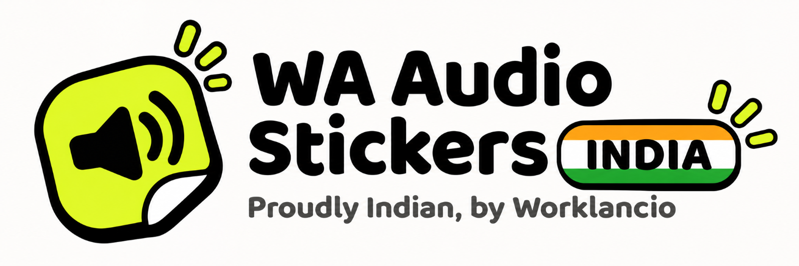
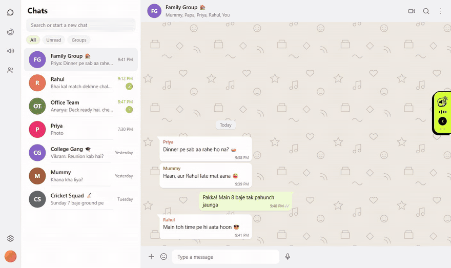
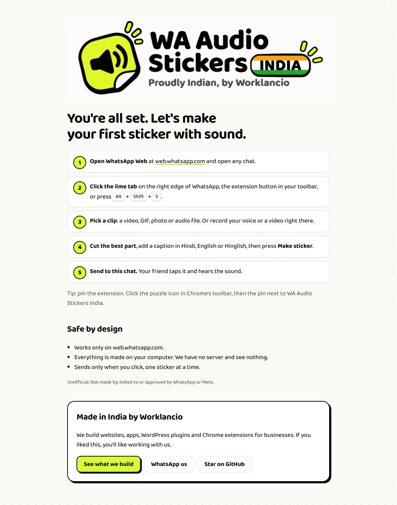
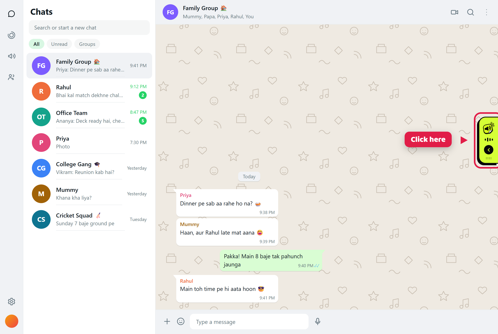
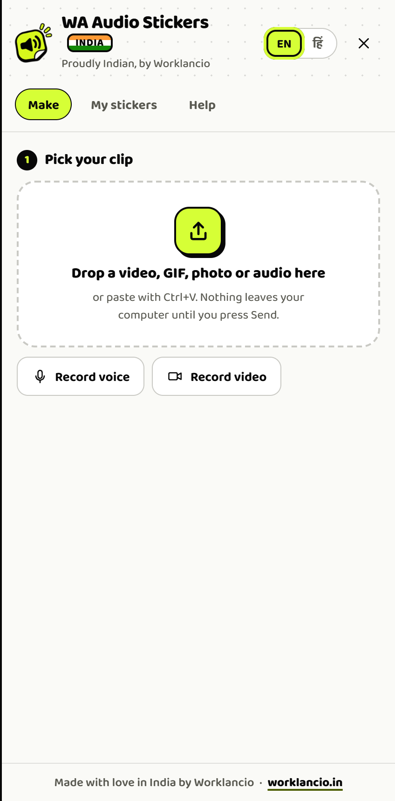
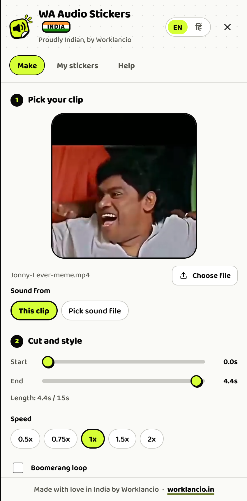
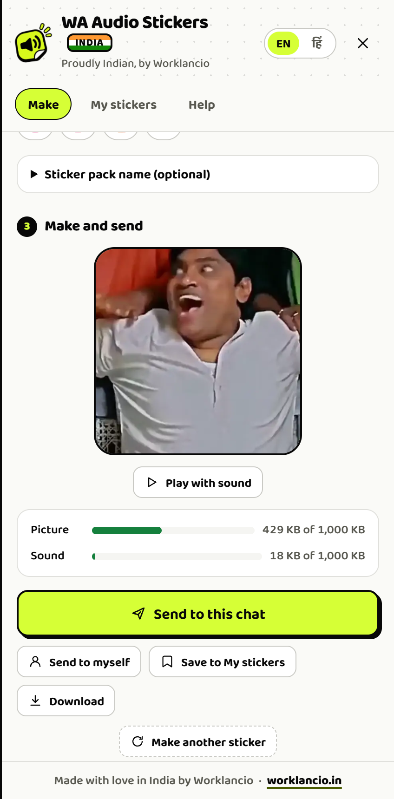
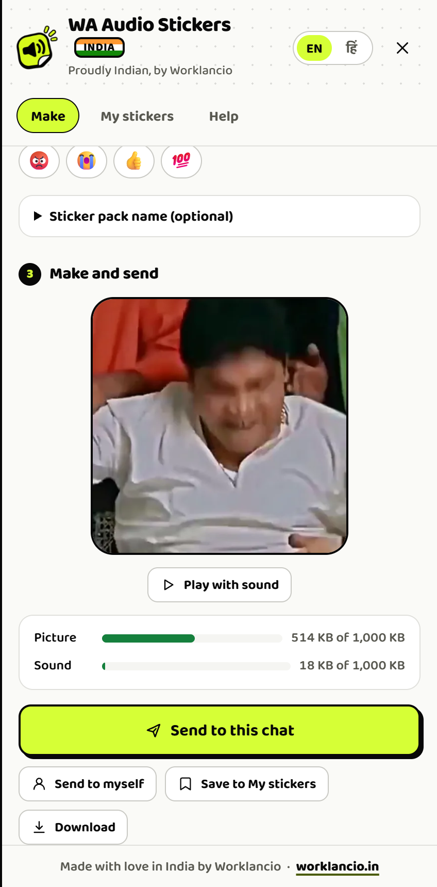

<div align="center">

<a href="https://github.com/xaviermsd/whatsapp-audio-stickers-india">
  <picture>
    <source media="(prefers-color-scheme: dark)" srcset="../brand/banner-dark.png">
    
  </picture>
</a>

### Bikin stiker WhatsApp yang ada suaranya, dari video, GIF, foto apa pun, atau suaramu sendiri.
### Gratis. Privat. Jalan di browser kamu. Bangga buatan India.

[](https://github.com/xaviermsd/whatsapp-audio-stickers-india/releases/latest)
[](../../LICENSE)
[](https://github.com/xaviermsd/whatsapp-audio-stickers-india/stargazers)


[English](../../README.md) · [हिंदी](README.hi.md) · [Português](README.pt-BR.md) · [Español](README.es.md) · **[Bahasa Indonesia](README.id.md)**

<br>



</div>

---

## ✨ Apa fungsinya

WA Audio Stickers India menambahkan tab kecil berwarna hijau lime di **WhatsApp Web**. Klik tab itu, masukkan klip,
potong bagian yang lucu, tambahkan teks, lalu tekan **"Send to this chat"**. Temanmu akan menerima stiker yang
mengeluarkan suara saat diketuk, di Android, iPhone, dan WhatsApp Web.

- 🎬 **Klip apa saja:** MP4, WebM, MOV, GIF, PNG, JPG, MP3, M4A, WAV, OGG.
- 🎙️ **Rekam langsung di WhatsApp:** suaramu, atau video selfie.
- ✂️ **Potong di gelombang suara, dengarkan bagiannya dulu, percepat, perlambat, bikin bolak-balik (boomerang),** keraskan suara, dan beri efek muncul dan hilang pelan.
- 🔤 **Teks dalam bahasa Hindi, Inggris, atau Hinglish,** dengan font Devanagari yang benar.
- 📦 **Koleksi "My stickers":** simpan stiker favorit dan kirim lagi dengan sekali klik.
- 🔒 **100% di komputermu.** Tanpa server, tanpa daftar akun, tanpa pelacakan.

> [!IMPORTANT]
> Ini adalah alat **tidak resmi**. Alat ini tidak dibuat oleh WhatsApp atau Meta, tidak terhubung dengan mereka, dan
> tidak disetujui oleh mereka. Baca [Pemakaian aman](#safe-use) sebelum mulai.

> [!NOTE]
> Aplikasinya tampil dalam bahasa Inggris (dan Hindi). Jadi di sini nama tombol tetap kami tulis dalam bahasa Inggris,
> persis seperti yang akan kamu lihat di layar.

---

## 🆕 Apa yang baru di versi kami

Kami mempelajari alat stiker bersuara open source yang ada saat ini (November 2026), lalu membuat versi kami sendiri
dari nol, dengan fitur yang tidak dimiliki satu pun dari alat itu:

| | Fitur | Kenapa penting |
|:-:|---|---|
| 🆕 | **Rekam suara** di panel | Bikin stiker suara dalam 5 detik. Tidak perlu file. |
| 🆕 | **Rekam video** pakai webcam | Stiker reaksimu sendiri, lengkap dengan suara, langsung jadi. |
| 🆕 | **Animasi stiker suara** | Audio biasa berubah jadi gelombang suara yang bergerak di atas kartu hijau lime, atau di atas fotomu sendiri. |
| 🆕 | **Teks Hindi, Inggris, dan Hinglish** | Huruf tebal bergaris tepi dengan font Baloo 2, yang punya huruf Devanagari asli. |
| 🆕 | **Aplikasi dalam bahasa Hindi dan Inggris** | Ganti dengan sekali ketuk: EN atau हिं. |
| 🆕 | **Bilah potong gelombang suara** | Lihat suaranya, geser dua pegangan, dengarkan bagian itu saja, atau ketik waktu tepatnya. |
| 🆕 | **Atur kecepatan** 0,5x sampai 2x | Drama gerak lambat atau komedi suara cempreng. |
| 🆕 | **Boomerang** | Diputar maju, lalu mundur. |
| 🆕 | **Koleksi "My stickers"** | Simpan sampai 60 stiker, favorit di paling atas, kirim ulang sekali klik. |
| 🆕 | **Ekspor dan impor paket** | Bagikan satu paket stiker utuh ke teman dalam satu file. |
| 🆕 | **Pengukur ukuran langsung** | Lihat persis seberapa dekat kamu dengan batas 1 MB dari WhatsApp. |
| 🆕 | **Batas keamanan bawaan** | Satu kiriman setiap kali, hanya ke chat yang sedang dibuka, dengan jeda singkat. |
| ✅ | Otomatis pas dengan batas WhatsApp | Kualitas, frame rate, dan ukuran diatur untukmu, jadi stiker selalu bisa dikirim. |
| ✅ | Nama paket stiker dan pembuat | Tampil di bawah stiker di HP temanmu. |

---

## 📥 Pasang dalam 2 menit

Bisa dipakai di **Chrome, Edge, dan Brave** di Windows, Mac, dan Linux (versi 116 atau lebih baru).

1. **Unduh** file terbaru `whatsapp-audio-stickers-india-vX.Y.Z.zip` dari
   **[Releases](https://github.com/xaviermsd/whatsapp-audio-stickers-india/releases/latest)**.
2. **Ekstrak** filenya. Kamu akan dapat folder bernama `whatsapp-audio-stickers-india`.
3. Buka halaman ekstensi di browsermu:
   - Chrome: `chrome://extensions`
   - Edge: `edge://extensions`
   - Brave: `brave://extensions`
4. Nyalakan **Mode pengembang** ("Developer mode"). Letaknya di kanan atas di Chrome dan Brave, dan di sisi kiri di
   Edge.
5. Klik **Muat yang belum dibuka** ("Load unpacked") lalu pilih folder yang sudah diekstrak tadi.
6. Halaman selamat datang akan terbuka. Selesai! Sematkan ekstensinya: klik ikon puzzle 🧩, lalu ikon pin 📌.

<details>
<summary><b>Lihat halaman selamat datang</b></summary>
<br>

</details>

<details>
<summary><b>Pasang dari kode sumber (untuk developer)</b></summary>

```bash
git clone https://github.com/xaviermsd/whatsapp-audio-stickers-india.git
```

Lalu ikuti langkah 3 sampai 5 di atas dan pilih folder `extension` di dalam repo.
</details>

> [!TIP]
> WhatsApp Web sudah terbuka sebelumnya? Muat ulang tabnya sekali setelah memasang, atau cukup klik tombol ekstensi
> dan kami akan memuat ulang untukmu.

---

## 🚀 Bikin stiker pertamamu

### 1. Buka WhatsApp Web dan klik tab hijau lime

Buka **[web.whatsapp.com](https://web.whatsapp.com)**, buka chat mana saja, lalu klik **tab hijau lime** di tepi
kanan. Kamu juga bisa klik tombol ekstensi atau tekan **Alt + Shift + S**.

<picture>
  <source media="(prefers-color-scheme: dark)" srcset="../screenshots/00-launcher-dark.png">
  
</picture>

<table>
<tr>
<td width="50%" valign="top">

### 2. Pilih klipmu

Taruh video, GIF, foto, atau file audio di kotaknya, klik untuk memilih file, atau tempel dengan **Ctrl + V**.

Tidak punya klip? Tekan **"Record voice"** (rekam suara) atau **"Record video"** (rekam video) dan bikin sekarang
juga (maksimal 15 detik).

</td>
<td width="50%">
<picture>
  <source media="(prefers-color-scheme: dark)" srcset="../screenshots/01-pick-dark.png">
  
</picture>
</td>
</tr>
<tr>
<td width="50%" valign="top">

### 3. Potong dan percantik

- Geser dua pegangan hijau lime di atas **gelombang suara** untuk mengambil bagian terbaik (maksimal 15 detik). Kelihatan bagian yang paling keras.
- Tekan **"Play this part"** untuk mendengar bagian itu saja, atau ketik waktu tepatnya di **"From"** dan **"To"**.
- Pilih kecepatan di **"Speed"**, nyalakan **"Boomerang loop"**, atur **"Volume"**.
- **"Make it louder"** menyamakan klip yang suaranya pelan. **"Soft fade in and out"** menghilangkan bunyi klik.
- **"Frame":** potong supaya kotaknya penuh, atau tampilkan seluruh gambar.
- Tulis teks di **"Caption"**: `Kya baat hai!` atau `क्या बात है!`
- Pilih **"Emoji tag"**, yaitu emoji yang dipakai WhatsApp di pencarian stiker.

</td>
<td width="50%">
<picture>
  <source media="(prefers-color-scheme: dark)" srcset="../screenshots/02-edit-dark.png">
  
</picture>
</td>
</tr>
<tr>
<td width="50%" valign="top">

### 4. Bikin stikernya

Tekan **"Make sticker"**. Butuh beberapa detik, semuanya di komputermu. Berubah pikiran? Tekan **"Cancel"** kapan saja.

**Pengukur ukuran** menunjukkan gambar dan suara dibandingkan batas 1.000 KB dari WhatsApp. Kalau perlu, kami
sendiri yang menurunkan kualitas, frame rate, atau ukurannya, jadi stiker selalu muat.

</td>
<td width="50%">
<picture>
  <source media="(prefers-color-scheme: dark)" srcset="../screenshots/04-ready-dark.png">
  
</picture>
</td>
</tr>
<tr>
<td width="50%" valign="top">

### 5. Kirim

- **"Send to this chat"** mengirimnya ke chat yang sedang kamu buka.
- **"Send to myself"** menaruhnya di chat "Anda" milikmu sendiri, jadi kamu bisa meneruskannya ke mana saja dari HP.
- **"Save to My stickers"** menyimpannya untuk lain kali.
- **"Download"** menyimpan gambar `.webp` dan suara `.ogg`.

Temanmu mengetuk stikernya dan mendengar suaranya. 🔊

</td>
<td width="50%">
<picture>
  <source media="(prefers-color-scheme: dark)" srcset="../screenshots/05-sent-dark.png">
  
</picture>
</td>
</tr>
</table>

---

<a id="safe-use"></a>

## 🛡️ Pemakaian aman dan privasi

| ✅ Yang kami lakukan | ❌ Yang tidak pernah kami lakukan |
|---|---|
| Hanya bekerja di `web.whatsapp.com` | Membaca situs web lain |
| Membuat stiker di komputermu sendiri | Mengunggah filemu ke server mana pun (kami tidak punya server) |
| Mengirim hanya saat kamu klik kirim | Mengirim massal, menjadwalkan, atau mengotomatiskan |
| Mengirim ke chat yang terbuka atau ke dirimu sendiri | Membaca chat, kontak, atau nomormu |
| Menyimpan stiker di browsermu | Melacakmu, menampilkan iklan, atau menjual data |

**Pakailah dengan bijak.** Add-on apa pun untuk WhatsApp Web punya sedikit risiko untuk akunmu. Kirim stiker ke orang
yang mengenalmu, satu per satu, dan jangan pernah dipakai untuk spam. Teman-temanmu perlu WhatsApp versi terbaru
supaya bisa mendengar suaranya.

Detail lengkapnya, dan cara kami memastikannya lewat pengujian: **[SECURITY.md](../../SECURITY.md)** (dalam bahasa
Inggris).

---

## 💬 Tanya jawab

<details>
<summary><b>Apakah gratis?</b></summary>
<br>Ya, sepenuhnya, dan open source dengan lisensi MIT. Tanpa daftar akun, tanpa iklan, tanpa paket berbayar.
</details>

<details>
<summary><b>Apakah temanku bisa mendengar suaranya?</b></summary>
<br>Bisa, kalau WhatsApp mereka sudah versi terbaru. Di Android dan iPhone suaranya diputar saat stiker diketuk.
WhatsApp versi lama akan menampilkan pesan bahwa pesan ini tidak didukung.
</details>

<details>
<summary><b>Bisa dipakai di HP?</b></summary>
<br>Tidak langsung: ini ekstensi browser komputer untuk WhatsApp Web. Tapi pakai <b>"Send to myself"</b>, lalu teruskan
atau beri bintang stikernya dari HP, dan stiker itu akan tetap ada di daftar stiker HP kamu.
</details>

<details>
<summary><b>Apakah bisa di Firefox atau Safari?</b></summary>
<br>Belum. Kami butuh fitur browser (encoding Opus lewat WebCodecs dan content script di tingkat halaman) yang saat ini
hanya ada di Chrome, Edge, dan Brave.
</details>

<details>
<summary><b>Berapa lama durasi maksimal stiker?</b></summary>
<br>Sampai 15 detik. Klip pendek (2 sampai 6 detik) terlihat paling tajam, karena WhatsApp membatasi setiap stiker
sekitar 1 MB untuk gambar dan 1 MB untuk suara.
</details>

<details>
<summary><b>Kenapa butuh kode internal WhatsApp Web?</b></summary>
<br>WhatsApp belum punya cara resmi untuk umum mengirim stiker bersuara dari komputer. Kami memakai fungsi unggah dan
kirim milik WhatsApp Web sendiri, jadi stiker terenkripsi end-to-end seperti pesan biasa. Kekurangannya: update
WhatsApp bisa membuat pengiriman rusak sampai kami memperbaruinya. Beri bintang di repo supaya kamu tahu kabar
perbaikannya.
</details>

<details>
<summary><b>Apakah akunku bisa diblokir?</b></summary>
<br>Kami membuatnya supaya bertingkah seperti orang biasa yang mengirim stiker: satu per satu, hanya saat kamu klik,
hanya ke chat yang terbuka. Kami belum pernah menerima laporan blokir dari pemakaian seperti ini, tapi WhatsApp tidak
menyetujui add-on apa pun, jadi kami tidak bisa menjanjikan apa-apa. Jangan pernah dipakai untuk pesan massal atau
spam.
</details>

<details>
<summary><b>Di mana stiker yang kusimpan disimpan?</b></summary>
<br>Di penyimpanan ekstensi browsermu, hanya di komputermu. Kalau ekstensinya dihapus, stiker itu ikut terhapus, jadi
pakai <b>"Export pack"</b> untuk cadangan.
</details>

---

## 🛠️ Mengatasi masalah

<details>
<summary><b>Tab hijau lime tidak muncul</b></summary>
<br>Muat ulang WhatsApp Web (F5). Cek apakah ekstensinya sudah aktif di halaman ekstensi. Tunggu sampai chat-mu selesai
dimuat.
</details>

<details>
<summary><b>"WhatsApp is still loading" (WhatsApp masih memuat)</b></summary>
<br>Tunggu beberapa detik setelah chat-mu muncul, lalu tekan kirim lagi.
</details>

<details>
<summary><b>"WhatsApp sent the picture without sound" (WhatsApp mengirim gambar tanpa suara)</b></summary>
<br>Mungkin stiker bersuara belum aktif di akunmu. Muat ulang WhatsApp Web dan coba lagi setelah 10 detik. Kalau masih
terus terjadi, buka tab "Help", tekan "Diagnostics", lalu kirim hasilnya ke kami lewat issue.
</details>

<details>
<summary><b>"We could not read the sound in this file" (kami tidak bisa membaca suara di file ini)</b></summary>
<br>Ubah klip ke MP4 atau MP3 lalu coba lagi. Beberapa file MKV dan AVI memakai format suara yang tidak bisa dibaca
browser.
</details>

<details>
<summary><b>"Too busy to fit the 1 MB limit" (terlalu ramai untuk muat di 1 MB)</b></summary>
<br>Potong bagian yang lebih pendek, atau pilih <b>"Show whole picture"</b>. Klip dengan banyak gerakan cepat ukurannya
lebih besar.
</details>

<details>
<summary><b>Mikrofon atau kamera diblokir</b></summary>
<br>Di WhatsApp Web, klik ikon kamera atau gembok di bilah alamat, izinkan mikrofon atau kamera, lalu coba lagi.
</details>

<details>
<summary><b>Pengiriman berhenti bekerja setelah update WhatsApp</b></summary>
<br>Buka <a href="https://github.com/xaviermsd/whatsapp-audio-stickers-india/issues">issue</a> dengan hasil
Diagnostics. Membuat stiker dan mengunduhnya tetap bisa selagi kami memperbaiki pengiriman.
</details>

---

## 💚 Dibuat oleh Worklancio

<div align="center">

<a href="https://www.worklancio.in/?utm_source=github&utm_medium=readme&utm_campaign=wa-audio-stickers">
  <picture>
    <source media="(prefers-color-scheme: dark)" srcset="../brand/worklancio-on-dark.png">
    
  </picture>
</a>

### Suka? Kami membuat situs web, aplikasi, dan alat seperti ini untuk bisnis.

Toko WordPress, WooCommerce, dan Shopify, aplikasi web dan dashboard khusus, ekstensi Chrome, fitur AI, SEO, dan
perawatan situs web. Dari India, untuk klien di seluruh dunia.

<a href="https://www.worklancio.in/services?utm_source=github&utm_medium=readme&utm_campaign=wa-audio-stickers"></a>
<a href="https://wa.me/919898528376?text=Hi%20Worklancio%2C%20I%20saw%20WA%20Audio%20Stickers%20on%20GitHub"></a>
<a href="mailto:hello@worklancio.in?subject=Project%20enquiry%20from%20GitHub"></a>

**Kalau ini bikin kamu senyum, beri ⭐ bintang di repo dan bagikan ke teman.** Dengan begitu lebih banyak orang bisa
menemukannya.

<sub>Bangga buatan India. Dibuat dengan cinta oleh Worklancio. Built by Harsh Prajapati.</sub>

</div>

---

Detail untuk developer (cara kerjanya, struktur proyek, pengujian, dan cara berkontribusi) ada di [README bahasa Inggris](../../README.md).

<sub>WhatsApp is a trademark of WhatsApp LLC. This project is not affiliated with, made by or endorsed by WhatsApp or Meta.</sub>
