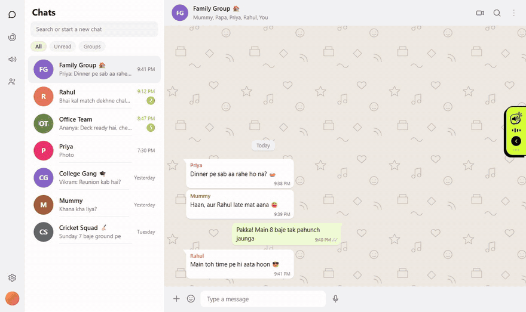
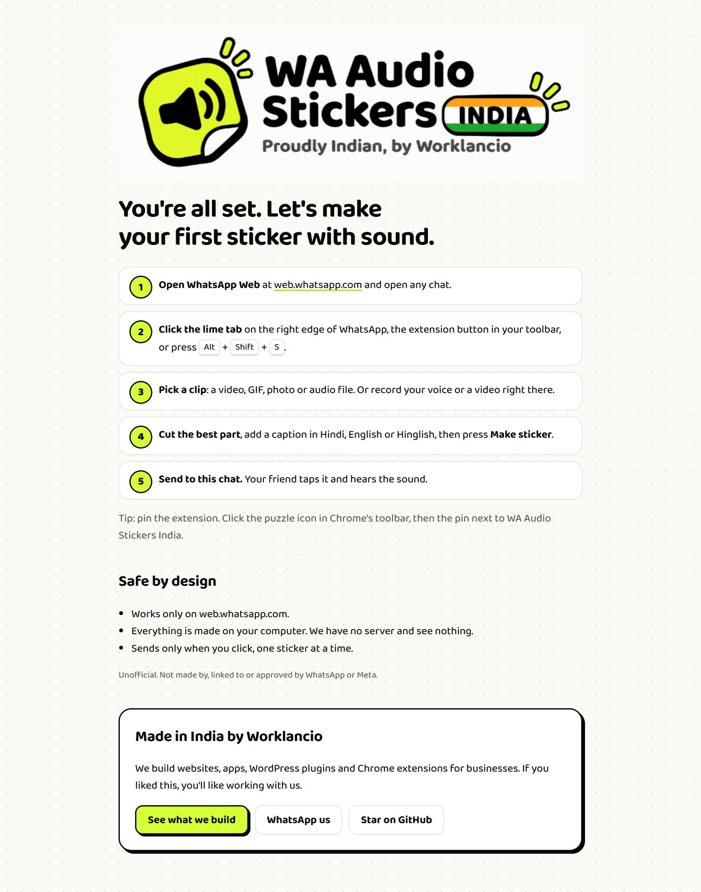
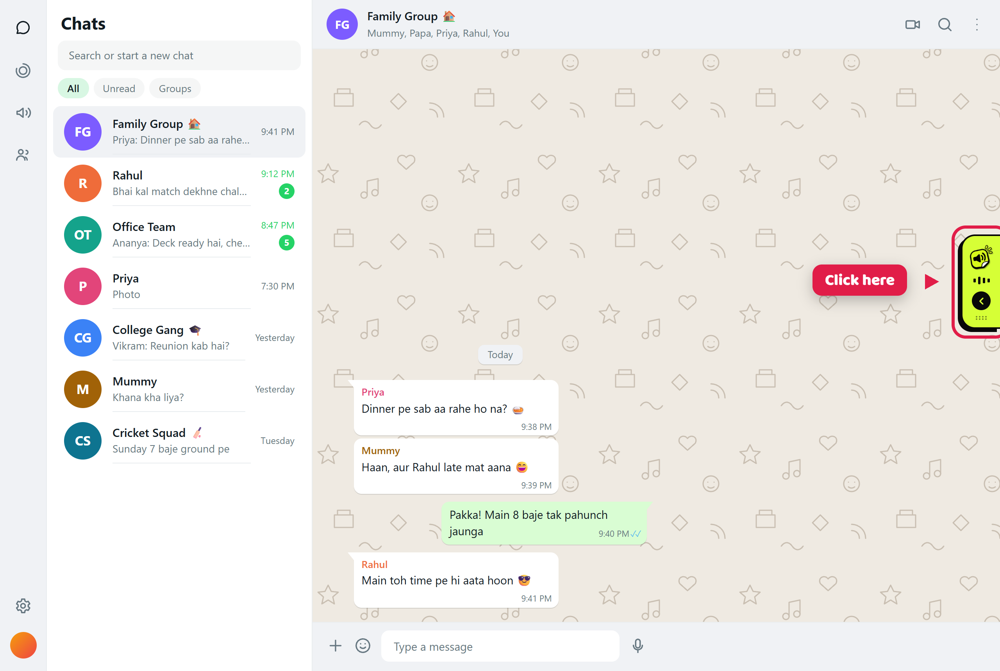
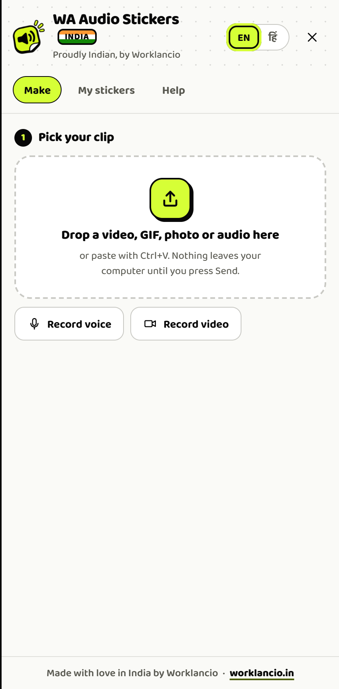
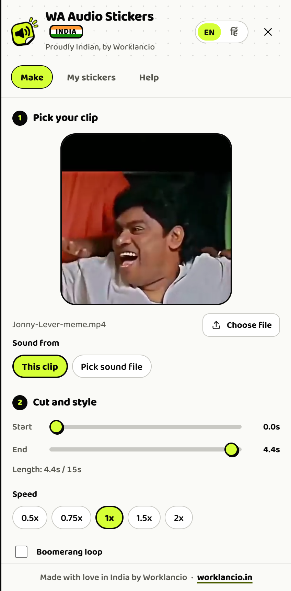
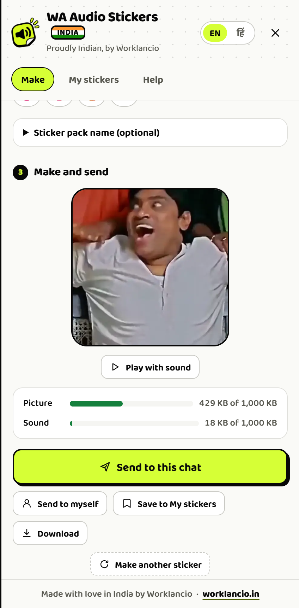
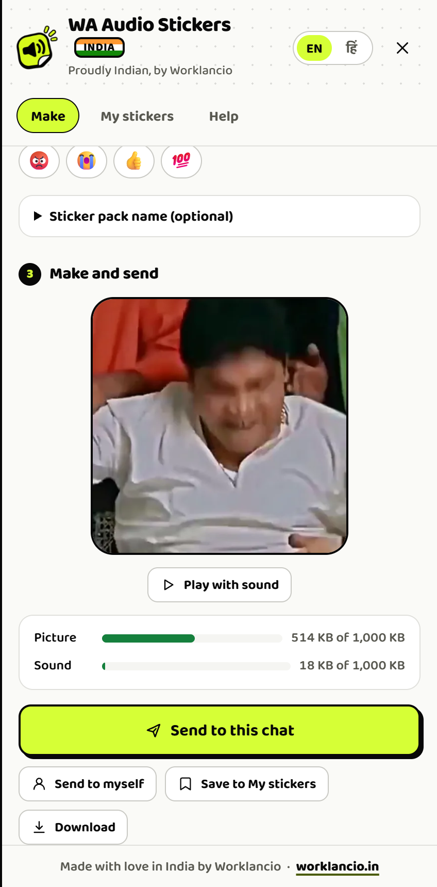

<div align="center">

<a href="https://github.com/xaviermsd/whatsapp-audio-stickers-india">
  <picture>
    <source media="(prefers-color-scheme: dark)" srcset="../brand/banner-dark.png">
    
  </picture>
</a>

### Crie figurinhas de WhatsApp com som a partir de qualquer vídeo, GIF, foto ou da sua própria voz.
### Grátis. Privado. Roda no seu navegador. Feito com orgulho na Índia.

[](https://github.com/xaviermsd/whatsapp-audio-stickers-india/releases/latest)
[](../../LICENSE)
[](https://github.com/xaviermsd/whatsapp-audio-stickers-india/stargazers)


[English](../../README.md) · [हिंदी](README.hi.md) · **[Português](README.pt-BR.md)** · [Español](README.es.md) · [Bahasa Indonesia](README.id.md)

<br>



</div>

---

## ✨ O que ele faz

O WA Audio Stickers India coloca uma pequena aba verde-limão no **WhatsApp Web**. Clique nela, solte um clipe, corte
a parte engraçada, coloque uma legenda e aperte **"Send to this chat"**. Seu amigo recebe uma figurinha que toca o som
quando ele encosta nela, no Android, no iPhone e no WhatsApp Web.

- 🎬 **Qualquer clipe:** MP4, WebM, MOV, GIF, PNG, JPG, MP3, M4A, WAV, OGG.
- 🎙️ **Grave direto no WhatsApp:** sua voz ou um vídeo de selfie.
- ✂️ **Corte numa forma de onda, ouça o trecho antes, acelere, deixe em câmera lenta, faça bumerangue,** aumente o volume, coloque entrada e saída suaves.
- 🔤 **Legendas em hindi, inglês ou hinglish,** com uma fonte devanágari de verdade.
- 📦 **Biblioteca "My stickers":** salve suas favoritas e envie de novo com um clique.
- 🔒 **100% no seu computador.** Sem servidor, sem cadastro, sem rastreamento.

> [!IMPORTANT]
> Esta é uma ferramenta **não oficial**. Ela não foi feita pelo WhatsApp nem pela Meta, não tem ligação com eles e não
> foi aprovada por eles. Leia [Uso seguro](#safe-use) antes de começar.

> [!NOTE]
> O app aparece em inglês (e em hindi). Por isso, os nomes dos botões ficam em inglês aqui, do jeito que você vai ver
> na tela.

---

## 🆕 O que tem de novo na nossa versão

Estudamos as ferramentas de figurinhas com som de código aberto que existem hoje (novembro de 2026) e criamos a nossa
do zero, com recursos que nenhuma delas tem:

| | Recurso | Por que importa |
|:-:|---|---|
| 🆕 | **Gravar voz** no painel | Faça uma figurinha de voz em 5 segundos. Não precisa de arquivo. |
| 🆕 | **Gravar vídeo** com a webcam | Sua própria figurinha de reação, com som, na hora. |
| 🆕 | **Animação para figurinha de voz** | Um áudio simples vira uma onda sonora em movimento num cartão verde-limão, ou em cima de uma foto sua. |
| 🆕 | **Legendas em hindi, inglês e hinglish** | Texto grosso com contorno na fonte Baloo 2, que tem letras devanágari de verdade. |
| 🆕 | **App em hindi e inglês** | Troque com um toque: EN ou हिं. |
| 🆕 | **Barra de corte com forma de onda** | Veja o som, arraste duas alças, ouça só o trecho ou digite os tempos exatos. |
| 🆕 | **Controle de velocidade** de 0,5x a 2x | Drama em câmera lenta ou comédia com voz de esquilo. |
| 🆕 | **Bumerangue** | Toca para frente e depois para trás. |
| 🆕 | **Biblioteca "My stickers"** | Até 60 figurinhas salvas, favoritas no topo, reenvio com um clique. |
| 🆕 | **Exportar e importar pacotes** | Compartilhe um pacote inteiro de figurinhas com os amigos em um só arquivo. |
| 🆕 | **Medidor de tamanho ao vivo** | Veja exatamente o quanto falta para os limites de 1 MB do WhatsApp. |
| 🆕 | **Limites de segurança já incluídos** | Um envio por vez, só para a conversa aberta, com um pequeno intervalo. |
| ✅ | Ajuste automático aos limites do WhatsApp | Qualidade, taxa de quadros e tamanho são ajustados para você, então sempre dá para enviar. |
| ✅ | Nome do pacote e autor | Aparecem embaixo da figurinha no celular do seu amigo. |

---

## 📥 Instale em 2 minutos

Funciona no **Chrome, Edge e Brave** no Windows, Mac e Linux (versão 116 ou mais nova).

1. **Baixe** o arquivo mais recente `whatsapp-audio-stickers-india-vX.Y.Z.zip` em
   **[Releases](https://github.com/xaviermsd/whatsapp-audio-stickers-india/releases/latest)**.
2. **Descompacte**. Você vai ter uma pasta chamada `whatsapp-audio-stickers-india`.
3. Abra a página de extensões do seu navegador:
   - Chrome: `chrome://extensions`
   - Edge: `edge://extensions`
   - Brave: `brave://extensions`
4. Ative o **Modo do desenvolvedor** ("Developer mode"). Ele fica no alto à direita no Chrome e no Brave, e do lado esquerdo no Edge.
5. Clique em **Carregar sem compactação** ("Load unpacked") e escolha a pasta descompactada.
6. Uma página de boas-vindas vai abrir. Pronto! Fixe a extensão: clique no ícone de quebra-cabeça 🧩 e depois no alfinete 📌.

<details>
<summary><b>Ver a página de boas-vindas</b></summary>
<br>

</details>

<details>
<summary><b>Instalar pelo código-fonte (para desenvolvedores)</b></summary>

```bash
git clone https://github.com/xaviermsd/whatsapp-audio-stickers-india.git
```

Depois siga os passos 3 a 5 acima e escolha a pasta `extension` dentro do repositório.
</details>

> [!TIP]
> O WhatsApp Web já estava aberto? Recarregue a aba uma vez depois de instalar, ou é só clicar no botão da extensão
> que a gente recarrega para você.

---

## 🚀 Faça sua primeira figurinha

### 1. Abra o WhatsApp Web e clique na aba verde-limão

Abra o **[web.whatsapp.com](https://web.whatsapp.com)**, entre em qualquer conversa e clique na **aba verde-limão** na
borda direita. Você também pode clicar no botão da extensão ou apertar **Alt + Shift + S**.

<picture>
  <source media="(prefers-color-scheme: dark)" srcset="../screenshots/00-launcher-dark.png">
  
</picture>

<table>
<tr>
<td width="50%" valign="top">

### 2. Escolha seu clipe

Solte um vídeo, GIF, foto ou áudio na caixa, clique para escolher um arquivo ou cole com **Ctrl + V**.

Não tem clipe? Aperte **"Record voice"** (gravar voz) ou **"Record video"** (gravar vídeo) e faça um agora mesmo
(até 15 segundos).

</td>
<td width="50%">
<picture>
  <source media="(prefers-color-scheme: dark)" srcset="../screenshots/01-pick-dark.png">
  
</picture>
</td>
</tr>
<tr>
<td width="50%" valign="top">

### 3. Corte e deixe do seu jeito

- Arraste as duas alças lima sobre a **forma de onda** para ficar só com a melhor parte (até 15 segundos). Dá para ver onde está o trecho mais alto.
- Aperte **"Play this part"** para ouvir só esse trecho, ou digite os tempos exatos em **"From"** e **"To"**.
- Escolha a velocidade em **"Speed"**, ligue o **"Boomerang loop"** e ajuste o volume em **"Volume"**.
- **"Make it louder"** equilibra clipes baixinhos. **"Soft fade in and out"** tira os estalos.
- **"Frame":** corte para preencher o quadrado ou mostre a imagem inteira.
- Escreva uma legenda em **"Caption"**: `Kya baat hai!` ou `क्या बात है!`
- Escolha o **"Emoji tag"**, o emoji que o WhatsApp usa na busca de figurinhas.

</td>
<td width="50%">
<picture>
  <source media="(prefers-color-scheme: dark)" srcset="../screenshots/02-edit-dark.png">
  
</picture>
</td>
</tr>
<tr>
<td width="50%" valign="top">

### 4. Crie a figurinha

Aperte **"Make sticker"**. Leva alguns segundos, tudo no seu computador. Mudou de ideia? Aperte **"Cancel"** a
qualquer momento.

O **medidor de tamanho** mostra a imagem e o som em relação aos limites de 1.000 KB do WhatsApp. Se precisar, a gente
mesmo baixa a qualidade, a taxa de quadros ou o tamanho, para sempre caber.

</td>
<td width="50%">
<picture>
  <source media="(prefers-color-scheme: dark)" srcset="../screenshots/04-ready-dark.png">
  
</picture>
</td>
</tr>
<tr>
<td width="50%" valign="top">

### 5. Envie

- **"Send to this chat"** envia para a conversa que está aberta.
- **"Send to myself"** manda para a sua própria conversa "Você", para você encaminhar para qualquer um pelo celular.
- **"Save to My stickers"** guarda para a próxima vez.
- **"Download"** salva a imagem `.webp` e o som `.ogg`.

Seu amigo toca na figurinha e ouve o som. 🔊

</td>
<td width="50%">
<picture>
  <source media="(prefers-color-scheme: dark)" srcset="../screenshots/05-sent-dark.png">
  
</picture>
</td>
</tr>
</table>

---

<a id="safe-use"></a>

## 🛡️ Uso seguro e privacidade

| ✅ Nós fazemos | ❌ Nós nunca |
|---|---|
| Funcionamos só no `web.whatsapp.com` | Lemos outros sites |
| Criamos as figurinhas no seu próprio computador | Enviamos seus arquivos para algum servidor (nem temos um) |
| Enviamos só quando você clica para enviar | Enviamos em massa, agendamos ou automatizamos |
| Enviamos para a conversa aberta ou para você mesmo | Lemos suas conversas, contatos ou números |
| Guardamos as figurinhas salvas no seu navegador | Rastreamos você, mostramos anúncios ou vendemos dados |

**Use com bom senso.** Qualquer complemento para o WhatsApp Web traz algum risco para a sua conta. Envie figurinhas
para quem conhece você, uma de cada vez, e nunca use para spam. Seus amigos precisam do WhatsApp atualizado para
ouvir o som.

Todos os detalhes, e como garantimos isso com testes: **[SECURITY.md](../../SECURITY.md)** (em inglês).

---

## 💬 Perguntas frequentes

<details>
<summary><b>É grátis?</b></summary>
<br>Sim, totalmente, e é código aberto sob a licença MIT. Sem cadastro, sem anúncios, sem plano pago.
</details>

<details>
<summary><b>Meu amigo vai ouvir o som?</b></summary>
<br>Sim, se o WhatsApp dele estiver atualizado. No Android e no iPhone o som toca quando ele encosta na figurinha.
Versões antigas do WhatsApp mostram uma mensagem dizendo que ela não é compatível.
</details>

<details>
<summary><b>Posso usar no celular?</b></summary>
<br>Não diretamente: é uma extensão de navegador de computador para o WhatsApp Web. Mas use <b>"Send to myself"</b>,
depois encaminhe ou favorite a figurinha pelo celular, e ela fica na sua bandeja de figurinhas.
</details>

<details>
<summary><b>Funciona no Firefox ou no Safari?</b></summary>
<br>Ainda não. Precisamos de recursos do navegador (codificação Opus via WebCodecs e content scripts no nível da
página) que hoje só o Chrome, o Edge e o Brave têm.
</details>

<details>
<summary><b>Qual a duração máxima de uma figurinha?</b></summary>
<br>Até 15 segundos. Clipes curtos (de 2 a 6 segundos) ficam mais nítidos, porque o WhatsApp limita cada figurinha a
cerca de 1 MB para a imagem e 1 MB para o som.
</details>

<details>
<summary><b>Por que ela precisa do código interno do WhatsApp Web?</b></summary>
<br>O WhatsApp ainda não tem um jeito público de enviar figurinhas com som pelo computador. Usamos as próprias funções
de upload e envio do WhatsApp Web, então as figurinhas têm criptografia de ponta a ponta como qualquer mensagem. O lado
ruim: uma atualização do WhatsApp pode quebrar o envio até a gente atualizar. Dê uma estrela no repositório para ficar
sabendo das correções.
</details>

<details>
<summary><b>Minha conta pode ser banida?</b></summary>
<br>Fizemos a ferramenta para agir como uma pessoa normal mandando uma figurinha: uma de cada vez, só quando você
clica, só para a conversa aberta. Não temos relatos de banimento por esse tipo de uso, mas o WhatsApp não aprova
nenhum complemento, então não podemos prometer nada. Nunca use para mensagens em massa ou spam.
</details>

<details>
<summary><b>Onde ficam minhas figurinhas salvas?</b></summary>
<br>No armazenamento de extensões do seu navegador, só no seu computador. Se você remover a extensão, elas são
apagadas, então use <b>"Export pack"</b> para ter um backup.
</details>

---

## 🛠️ Resolvendo problemas

<details>
<summary><b>Não estou vendo a aba verde-limão</b></summary>
<br>Recarregue o WhatsApp Web (F5). Confira se a extensão está ativada na página de extensões. Espere suas conversas
carregarem.
</details>

<details>
<summary><b>"WhatsApp is still loading" (o WhatsApp ainda está carregando)</b></summary>
<br>Espere alguns segundos depois que as conversas aparecerem e aperte para enviar de novo.
</details>

<details>
<summary><b>"WhatsApp sent the picture without sound" (o WhatsApp enviou a imagem sem som)</b></summary>
<br>Talvez as figurinhas com som ainda não estejam ativadas na sua conta. Recarregue o WhatsApp Web e tente de novo
depois de 10 segundos. Se continuar acontecendo, abra a aba "Help", aperte "Diagnostics" e mande o resultado para nós
numa issue.
</details>

<details>
<summary><b>"We could not read the sound in this file" (não conseguimos ler o som deste arquivo)</b></summary>
<br>Converta o clipe para MP4 ou MP3 e tente de novo. Alguns arquivos MKV e AVI usam formatos de som que os
navegadores não conseguem ler.
</details>

<details>
<summary><b>"Too busy to fit the 1 MB limit" (movimento demais para caber em 1 MB)</b></summary>
<br>Corte um trecho menor ou escolha <b>"Show whole picture"</b>. Clipes com muito movimento rápido ficam maiores.
</details>

<details>
<summary><b>Microfone ou câmera bloqueados</b></summary>
<br>No WhatsApp Web, clique no ícone de câmera ou de cadeado na barra de endereço, permita o microfone ou a câmera e
tente de novo.
</details>

<details>
<summary><b>O envio parou de funcionar depois de uma atualização do WhatsApp</b></summary>
<br>Abra uma <a href="https://github.com/xaviermsd/whatsapp-audio-stickers-india/issues">issue</a> com o resultado do
Diagnostics. Criar e baixar figurinhas continua funcionando enquanto a gente conserta o envio.
</details>

---

## 💚 Feito pela Worklancio

<div align="center">

<a href="https://www.worklancio.in/?utm_source=github&utm_medium=readme&utm_campaign=wa-audio-stickers">
  <picture>
    <source media="(prefers-color-scheme: dark)" srcset="../brand/worklancio-on-dark.png">
    
  </picture>
</a>

### Gostou? Criamos sites, apps e ferramentas como esta para empresas.

Lojas WordPress, WooCommerce e Shopify, apps web e painéis sob medida, extensões para Chrome, recursos de IA, SEO e
manutenção de sites. Da Índia, para clientes do mundo todo.

<a href="https://www.worklancio.in/services?utm_source=github&utm_medium=readme&utm_campaign=wa-audio-stickers"></a>
<a href="https://wa.me/919898528376?text=Hi%20Worklancio%2C%20I%20saw%20WA%20Audio%20Stickers%20on%20GitHub"></a>
<a href="mailto:hello@worklancio.in?subject=Project%20enquiry%20from%20GitHub"></a>

**Se isso te fez sorrir, dê uma ⭐ estrela no repositório e mande para um amigo.** Assim mais gente encontra a
ferramenta.

<sub>Orgulhosamente indiano. Feito com carinho pela Worklancio. Built by Harsh Prajapati.</sub>

</div>

---

Detalhes para desenvolvedores (como funciona, estrutura do projeto, testes e como contribuir) estão no [README em inglês](../../README.md).

<sub>WhatsApp is a trademark of WhatsApp LLC. This project is not affiliated with, made by or endorsed by WhatsApp or Meta.</sub>
